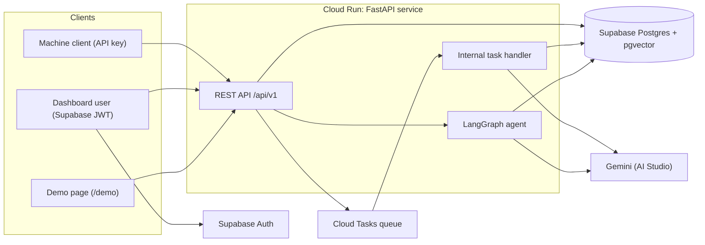
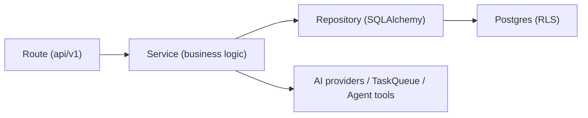
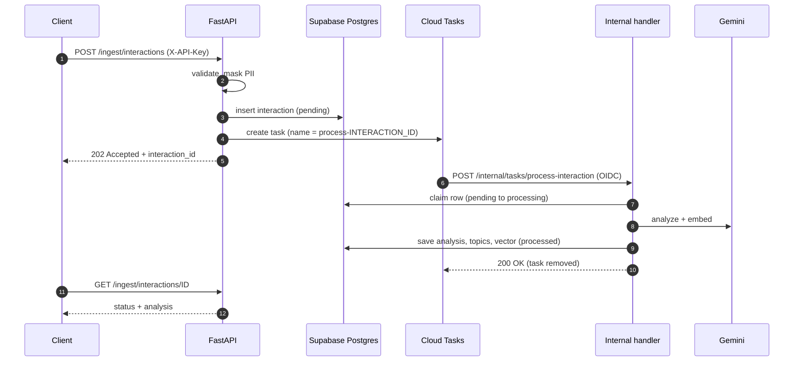
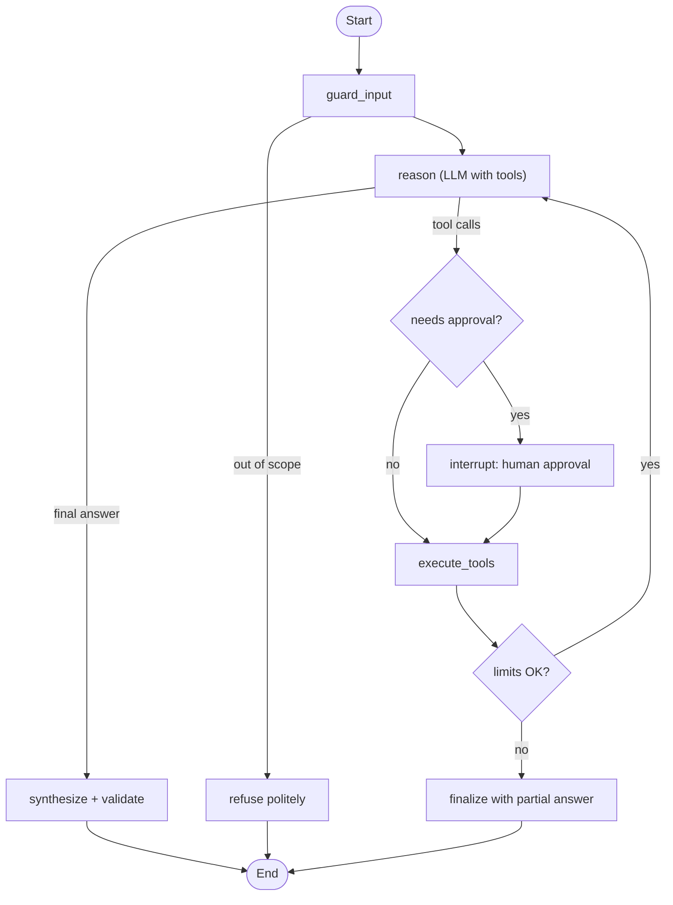
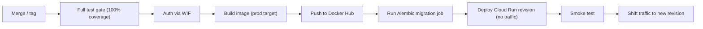

# CogniVoice API — MASTERPLAN

## Table of Contents

1. [Project Overview](#1-project-overview)
2. [Architectural Decisions](#2-architectural-decisions)
3. [Tech Stack](#3-tech-stack)
4. [Architecture](#4-architecture)
5. [Roles and Permissions](#5-roles-and-permissions)
6. [Data Model](#6-data-model)
7. [API Specification](#7-api-specification)
8. [Ingestion Pipeline and Cloud Tasks](#8-ingestion-pipeline-and-cloud-tasks)
9. [AI Layer](#9-ai-layer)
10. [AI Agent (LangGraph)](#10-ai-agent-langgraph)
11. [Documentation and Demo](#11-documentation-and-demo)
12. [Environments, Configuration and Secrets](#12-environments-configuration-and-secrets)
13. [CI/CD and Infrastructure as Code](#13-cicd-and-infrastructure-as-code)
14. [Repository, Structure and Workflow](#14-repository-structure-and-workflow)
15. [Git Hooks and Commit Conventions](#15-git-hooks-and-commit-conventions)
16. [AI Assistant Files (AGENTS.md and CLAUDE.md)](#16-ai-assistant-files-agentsmd-and-claudemd)
17. [Testing Strategy and Quality Gates](#17-testing-strategy-and-quality-gates)
18. [Security](#18-security)
19. [Monitoring and Observability](#19-monitoring-and-observability)
20. [Performance and Scalability](#20-performance-and-scalability)
21. [Backup and Disaster Recovery](#21-backup-and-disaster-recovery)
22. [Operational Runbooks](#22-operational-runbooks)
23. [Data Retention and Privacy](#23-data-retention-and-privacy)
24. [Cost Model](#24-cost-model)
25. [Roadmap and To-Do Checklists](#25-roadmap-and-to-do-checklists) (includes the [Production Readiness Checklist](#251-production-readiness-checklist))
26. [Open Points](#26-open-points)
27. [Documentation Deliverables](#27-documentation-deliverables)

---

## 1. Project Overview

**CogniVoice** (Cognitive Voice of the Customer) is a B2B, API-first platform. Companies push raw customer text (emails, chat transcripts, app reviews, support tickets, social comments) into the API. CogniVoice masks personal data, analyzes the text with an LLM (sentiment, emotion, topics, summary), stores a semantic embedding, and exposes the results through analytics endpoints, semantic search, and an **AI agent** that answers natural-language questions by calling those capabilities as tools.

**Data philosophy: "Payloads, not files."** The service handles only UTF-8 text, JSON, and vectors. It never stores documents or binary data. Clients extract text from their own files before sending it. Requests that are not `application/json` are rejected.

### Goals

1. A production-shaped, **multi-tenant REST API** with strong isolation (application layer plus PostgreSQL Row Level Security).
2. A showcase of **applied AI engineering**: structured LLM extraction, embeddings and semantic search, a tool-using **LangGraph agent**, a provider abstraction (Gemini in the cloud, Ollama locally), agent guardrails, and systematic agent evaluation.
3. A showcase of **engineering practice**: clean layering, migrations, test-first development with a 100% coverage gate, tests that prove tenant isolation, Docker, Terraform, GitHub Actions with keyless GCP authentication, enforced commit conventions, and excellent API documentation.

---

## 2. Architectural Decisions

| #   | Area                      | Decision                                                                                                                                                                                                                                                                                                                                                                                                                                               | Rationale                                                                 |
| --- | ------------------------- | ------------------------------------------------------------------------------------------------------------------------------------------------------------------------------------------------------------------------------------------------------------------------------------------------------------------------------------------------------------------------------------------------------------------------------------------------------ | ------------------------------------------------------------------------- |
| 1   | Language                  | **Python 3.14** is a hard requirement. A dependency that blocks it is resolved by pinning a newer release, adding a thin adapter, or replacing that dependency; never by downgrading Python                                                                                                                                                                                                                                                            | Project requirement; verified by the Phase 0 compatibility spike          |
| 2   | API                       | FastAPI (async), Pydantic v2, versioned REST under `/api/v1`                                                                                                                                                                                                                                                                                                                                                                                           | Standard, typed, self-documenting                                         |
| 3   | ORM / migrations          | SQLAlchemy 2.x async with Alembic                                                                                                                                                                                                                                                                                                                                                                                                                      | Mature async support; migrations under version control                    |
| 4   | Database                  | **Supabase** (Postgres + pgvector + Auth). Local development uses the Supabase emulator in Docker. **No Cloud SQL**                                                                                                                                                                                                                                                                                                                                    | Single managed platform for data, vectors, and identity                   |
| 5   | Tenant isolation          | Tenant-scoped repositories **plus** RLS on a non-owner, non-bypass role (§6.3)                                                                                                                                                                                                                                                                                                                                                                         | Defence in depth; RLS alone is bypassed by privileged roles               |
| 6   | Roles                     | Super Admin, Tenant Admin, Tenant Viewer, Machine (API key)                                                                                                                                                                                                                                                                                                                                                                                            | Separates platform, tenant, read-only, and system access                  |
| 7   | AI orchestration          | **LangGraph**, ReAct-style agent                                                                                                                                                                                                                                                                                                                                                                                                                       | Explicit graph, checkpointing, interrupt support                          |
| 8   | AI providers              | Cloud: Gemini via AI Studio API key, cheapest suitable model (default `gemini-2.5-flash-lite`, set by `GEMINI_MODEL`). Local: Ollama, default `llama3.2:3b` (optional `llama3.1:8b`). **Ollama is local only**; deployed environments use Gemini                                                                                                                                                                                                       | Cost control; local development with no paid credits                      |
| 9   | Embeddings                | One `vector(768)` column; every row stores `embedding_model`; search filters on the active model                                                                                                                                                                                                                                                                                                                                                       | Vectors from different models are never comparable                        |
| 10  | Input policy              | Max **1,000 characters** per item; PII masking is **mandatory** before storage or any LLM call                                                                                                                                                                                                                                                                                                                                                         | Cost control and data minimization                                        |
| 11  | Queue                     | **Cloud Tasks** in the cloud; DB-polling worker locally, behind one `TaskQueue` interface (§8)                                                                                                                                                                                                                                                                                                                                                         | Durable, retried, rate-limited delivery without running workers           |
| 12  | Scope exclusions          | No webhooks, alerts, quotas, rate limiting, or billing in v1                                                                                                                                                                                                                                                                                                                                                                                           | Keeps v1 focused; tables `webhooks` and `usage_logs` are not created      |
| 13  | Documentation             | Swagger UI (`/docs`), ReDoc (`/redoc`), Tailwind-styled `/demo` page                                                                                                                                                                                                                                                                                                                                                                                   | Runnable explanation of the backend                                       |
| 14  | Environments              | `local`, `development`, `staging`, `production`. No PR previews. One GCP project per cloud environment: `moliveda-gcloudprojects-dev`, `-stg`, `-prod`; region `us-central1`                                                                                                                                                                                                                                                                           | Isolation of data, secrets, and blast radius                              |
| 15  | GCP authentication        | **Workload Identity Federation**; no long-lived service-account keys. Each environment project already has a WIF pool (`github-pool`) and a deployer service account (`cicd-deployer-dev`, `cicd-deployer-stg`, `cicd-deployer-prod`); these are **reused, not recreated** (verify with `gcloud iam service-accounts list` and `gcloud iam workload-identity-pools list`). Runtime secrets live in **GitHub Secrets**, not Secret Manager (§12, §13.1) | Keyless, least privilege                                                  |
| 16  | Infrastructure as code    | Terraform is included **only as a showcase**: `terraform fmt -check` and `terraform validate` run in hooks and CI; `terraform apply` is never run. The GCP projects already contain other resources, so Terraform must not manage or mix with them. The cloud environments are configured with versioned shell scripts (`gcloud`) and CI/CD pipelines (§13.3)                                                                                          | Demonstrates infrastructure skills without touching existing projects     |
| 17  | Containers                | **One multi-stage** `Dockerfile` (`development`, `staging` and `production` targets) and **one** `docker-compose.yaml`**, used only locally**. Cloud Run runs the `development`, `staging` and `production` targets. This deliberately replaces the charter's multi-file Docker layout                                                                                                                                                                 | Compose is local-only, so per-environment compose files add no value      |
| 18  | Testing                   | **Test-first.** Every feature ships with its tests. **100% merged line and branch coverage** is enforced from the first commit of application code. Agent quality is evaluated with DeepEval (§17)                                                                                                                                                                                                                                                     | Untested code must never merge or deploy                                  |
| 19  | Git workflow              | GitFlow, Semantic Versioning, Gitmoji commit messages, `pre-commit` framework hooks in three stages, re-verified in CI (§15)                                                                                                                                                                                                                                                                                                                           | Consistent history; hooks can be bypassed, CI cannot                      |
| 20  | AI assistant files        | `AGENTS.md` is the single source of rules; `CLAUDE.md` is a symlink to it (§16)                                                                                                                                                                                                                                                                                                                                                                        | One rule set, no duplication                                              |
| 21  | Typing style              | `Optional[X]` for optional types, as the charter states                                                                                                                                                                                                                                                                                                                                                                                                | Charter convention                                                        |
| 22  | Demo availability         | Enabled in **every** environment, including production, by default (`DEMO_ENABLED=true`), so external people can test the app. It is read-only and pinned to the demo tenant (§11); it can still be switched off with `DEMO_ENABLED=false`                                                                                                                                                                                                             | Public, safe, read-only demo access; AI cost is bounded by caps (§24.2)   |
| 23  | Naming and licence        | Repository `cognivoice_api`; product name CogniVoice; **GPL-2.0-or-later** licence (GNU General Public License v2 or any later version; SPDX `GPL-2.0-or-later`), chosen so Apache-2.0 runtime dependencies can be combined under GPLv3 (§26). Runtime dependency licences are checked for compatibility (§26)                                                                                                                                         | Project convention; the `LICENSE` file holds the full GPLv2 text          |
| 24  | Local Supabase and Ollama | **One single `docker-compose.yaml`** runs the whole local stack: the Supabase services (Postgres + pgvector, Auth, API gateway, Studio), the `api` and the `worker`, so `docker compose up` starts everything together. Ollama runs natively on the Mac host (Metal acceleration) and is reached at `host.docker.internal:11434`                                                                                                                       | One command to start; Docker on Apple Silicon has no GPU access           |
| 25  | Observability             | Standard Python `logging` with structured JSON on stdout (captured by Cloud Run's built-in log retention) plus the free Cloud Run console metrics; no paid dashboards, alert policies, or log buckets. Optional OpenTelemetry (`TRACING_ENABLED`). Detailed in §19                                                                                                                                                                                     | Low cost for a personal/academic project, still traceable by `request_id` |
| 26  | Operations and recovery   | Documented performance targets and load testing (§20), backup/PITR with RTO/RPO per environment (§21), runbooks and incident process (§22), retention and erasure (§23)                                                                                                                                                                                                                                                                                | A system is only production-ready if it can be operated and restored      |
| 27  | API lifecycle             | Path-based major versions; 6-month deprecation with `Deprecation`/`Sunset` headers; backward-compatible changes only within a major version (§7.8). Expand/contract migrations (§13.5)                                                                                                                                                                                                                                                                 | Predictable evolution for clients and zero-downtime deploys               |
| 28  | Images and secrets        | Container images are stored in **Docker Hub** (not Artifact Registry). All secrets (Docker Hub token, Gemini key, database URLs, Supabase keys) are stored in **GitHub Secrets** (not Secret Manager). No Google Cloud secret or registry service is used                                                                                                                                                                                              | Simpler and cheaper; everything is managed from the GitHub repository     |
| 29  | LLM data format           | Data sent **to** the LLM (retrieved interactions, tool results, analytics context) is encoded in **TOON** ([Token-Oriented Object Notation](https://github.com/toon-format/toon)) instead of JSON. Structured output **from** the LLM is still validated with Pydantic (§9.2)                                                                                                                                                                          | Fewer tokens for the same data, which lowers cost and latency             |

---

## 3. Tech Stack

| Area               | Choice                                                                                                              |
| ------------------ | ------------------------------------------------------------------------------------------------------------------- |
| Language / runtime | Python 3.14                                                                                                         |
| API framework      | FastAPI (async), Pydantic v2, `pydantic-settings`                                                                   |
| ORM / migrations   | SQLAlchemy 2.x (async, `asyncpg`), Alembic, `pgvector` Python package                                               |
| Database / auth    | Supabase: PostgreSQL + pgvector + Supabase Auth (JWT)                                                               |
| AI orchestration   | LangGraph (+ LangChain chat and embedding integrations)                                                             |
| Cloud LLM          | Gemini via AI Studio (`langchain-google-genai`)                                                                     |
| Local LLM          | Ollama (`langchain-ollama`): `llama3.2:3b`, embeddings `nomic-embed-text`                                           |
| LLM data format    | TOON (Token-Oriented Object Notation, `toon-format` package) for data sent to the LLM; Pydantic for validation      |
| Queue              | Google Cloud Tasks (cloud) · DB-polling worker (local)                                                              |
| Compute            | Google Cloud Run (one service per project)                                                                          |
| Registry / secrets | Docker Hub (images) · GitHub Secrets (secrets and tokens)                                                           |
| IaC                | Terraform (format and validation only; never applied) + `gcloud` setup scripts                                      |
| CI/CD              | GitHub Actions, Workload Identity Federation                                                                        |
| Containers         | Docker (single multi-stage `Dockerfile`), one Docker Compose file (local only) that also runs the Supabase services |
| Code quality       | Black, isort, flake8, pylint, mypy (strict), Bandit, pip-audit, gitleaks                                            |
| Git hooks          | Python `pre-commit` framework (pre-commit, commit-msg, pre-push stages)                                             |
| Testing            | pytest, pytest-asyncio, pytest-cov (branch), pytest-mock, httpx, Testcontainers, Hypothesis, respx                  |
| Agent evaluation   | DeepEval (pytest-native), with a Gemini judge model                                                                 |
| Dependencies       | `pip` + `pip-tools` (`requirements.in` → pinned `requirements.txt` and `requirements-dev.txt`), venv in `.venv`     |
| Dependency policy  | Dependabot + monthly review, 48 h security patches, quarterly major upgrades, hashed pins (§13.6)                   |
| Observability      | Python `logging` (structured JSON on stdout), Cloud Run console metrics, optional OpenTelemetry (§19)               |
| Load testing       | Locust (§20.5)                                                                                                      |
| Task runner        | `Makefile`                                                                                                          |
| Demo UI            | Single HTML page, Tailwind CSS (CDN script, demo only)                                                              |

---

## 4. Architecture

### 4.1 System overview



Secrets are not stored in Google Cloud: they live in **GitHub Secrets** and are injected into the Cloud Run revision as environment variables by the deploy workflow (§13.1).

Locally, all services start from the single `docker-compose.yaml`, including the Supabase services. Cloud Tasks is replaced by a polling `worker` container, and Gemini by Ollama running on the host.

### 4.2 Layering



- **Routes** validate input (Pydantic), resolve identity (dependencies), call one service, and shape the response model. No business logic.
- **Services** hold business rules (PII masking, ingestion, analysis, analytics, tenant and key management). They depend on abstractions: `TaskQueue`, `LLMProvider`, `EmbeddingProvider`.
- **Repositories** are the only place SQL/ORM code lives. Every repository method takes a tenant-scoped session; none accept a raw `tenant_id` from callers.
- **Agent tools** are thin wrappers over the same services the REST endpoints use, so the API and the agent can never disagree.
- Patterns applied: Repository, Factory (provider factory), Strategy (task queue and AI provider implementations), Dependency Injection (FastAPI `Depends`), Builder (agent graph assembly).

### 4.3 Key design decisions

- **No FastAPI** `BackgroundTasks` **for AI work in the cloud.** On Cloud Run with request-based billing, CPU is throttled after the response is sent, so background work is unreliable. Cloud Tasks gives durable, retried, rate-limited delivery.
- **Same code path locally and in the cloud.** Both the Cloud Tasks handler and the local worker call one `ProcessInteractionService`.
- **Error envelope** on every failure: `{"error": {"code": "...", "message": "...", "details": {...}, "request_id": "..."}}`, produced by global exception handlers (validation, auth, not found, DB unavailable, AI provider failure).
- **Cursor (keyset) pagination** on list endpoints: `limit` (max 100) and `cursor`.
- **UTC everywhere**; ISO 8601 timestamps.

---

## 5. Roles and Permissions

| Capability                             | Super Admin | Tenant Admin | Tenant Viewer |  Machine (API key)  |
| -------------------------------------- | :---------: | :----------: | :-----------: | :-----------------: |
| Onboard / list / deactivate tenants    |     ✅      |      –       |       –       |          –          |
| System stats (counts only, no content) |     ✅      |      –       |       –       |          –          |
| Manage own tenant, users, API keys     |      –      |      ✅      |       –       |          –          |
| Read interactions, analytics, search   |      –      |      ✅      |      ✅       |          –          |
| Ask the AI agent                       |      –      |      ✅      |      ✅       |          –          |
| Ingest text                            |      –      |      –       |       –       | ✅ (`ingest:write`) |
| Read ingestion status/result           |      –      |      –       |       –       | ✅ (`ingest:read`)  |

### Roles and Permissions: Authentication

- **Humans** (Super Admin, Tenant Admin, Tenant Viewer) authenticate with **Supabase Auth**, then send `Authorization: Bearer <JWT>`. FastAPI verifies the token, then loads the user's **role and tenant from our own** `users` **table** (not from JWT claims), so a role change or deactivation takes effect immediately.
- **Machines** send `X-API-Key: <key>`. Keys look like `cvk_<env>_<prefix>_<secret>`; the environment tag stops a dev key from working in prod.
- The API does not proxy login or signup; Supabase Auth owns that. Swagger documents both security schemes (`BearerAuth`, `ApiKeyAuth`).

**Privacy by design:** the Super Admin can manage tenants and see aggregate system counts, but **cannot read tenant feedback content**. Content tables have no super-admin RLS bypass.

**Onboarding:** the Super Admin creates a tenant and the API invites the tenant's first Tenant Admin by email through the Supabase Auth admin API. No API key is generated at onboarding; the Tenant Admin creates keys, which limits secret exposure. `scripts/create_super_admin.py` creates the first Super Admin per environment.

---

## 6. Data Model

### 6.1 Tables

| Table                 | Purpose                                                                            | Key columns                                                                                                                                                                                                                                                                                                                   |
| --------------------- | ---------------------------------------------------------------------------------- | ----------------------------------------------------------------------------------------------------------------------------------------------------------------------------------------------------------------------------------------------------------------------------------------------------------------------------- |
| `tenants`             | A client company                                                                   | `id`, `name`, `slug` (unique), `is_active`, `created_at`, `updated_at`                                                                                                                                                                                                                                                        |
| `users`               | Dashboard users; `id` equals the Supabase `auth.users.id`                          | `id`, `tenant_id` (null for Super Admin), `email`, `role` (`super_admin` / `tenant_admin` / `tenant_viewer`), `is_active`                                                                                                                                                                                                     |
| `api_keys`            | Machine credentials, separate from tenants so they can be scoped, rotated, revoked | `id`, `tenant_id`, `name`, `prefix` (indexed), `key_hash`, `scopes[]`, `expires_at`, `revoked_at`, `last_used_at`, `created_by`, `created_at`                                                                                                                                                                                 |
| `interactions`        | Ingested text (masked) and processing state                                        | `id`, `tenant_id`, `source_type`, `text_content` (≤1000), `language`, `external_id`, `metadata` (JSONB, ≤2 KB), `status` (`pending` / `processing` / `processed` / `failed`), `attempts`, `processing_started_at`, `processing_error`, `pii_redactions` (JSONB counts), `created_by_api_key_id`, `created_at`, `processed_at` |
| `analysis_results`    | LLM output (1:1 with interaction)                                                  | `interaction_id` (PK/FK), `tenant_id`, `sentiment_score` (−1..1), `sentiment_label`, `emotion`, `summary`, `analysis_model`, `prompt_version`, `prompt_tokens`, `completion_tokens`, `created_at`                                                                                                                             |
| `topics`              | Normalized topic vocabulary per tenant                                             | `id`, `tenant_id`, `name` (lowercase, unique per tenant), `created_at`                                                                                                                                                                                                                                                        |
| `interaction_topics`  | Many-to-many link, needed for topic analytics                                      | `interaction_id`, `topic_id`, `tenant_id`                                                                                                                                                                                                                                                                                     |
| `interaction_vectors` | Embeddings for semantic search                                                     | `interaction_id` (PK/FK), `tenant_id`, `embedding` `vector(768)`, `embedding_model`, `created_at`                                                                                                                                                                                                                             |
| `agent_threads`       | Conversation ownership for agent memory                                            | `id`, `tenant_id`, `user_id`, `title`, `created_at`                                                                                                                                                                                                                                                                           |
| `agent_runs`          | Audit trail and trace of each agent run                                            | `id`, `thread_id`, `tenant_id`, `user_id`, `question`, `answer`, `status`, `provider`, `model`, `steps` (JSONB tool-call trace), `total_tokens`, `latency_ms`, `created_at`                                                                                                                                                   |

LangGraph's Postgres checkpointer creates its own tables in a separate `langgraph` schema; they are managed by the library.

### 6.2 Enumerations and rules

- `source_type`: `email`, `chat_transcript`, `app_review`, `support_ticket`, `social_comment`.
- `emotion`: `delighted`, `satisfied`, `neutral`, `confused`, `frustrated`, `angry`, `urgent`.
- `sentiment_label` is **derived in code** from `sentiment_score` (≥ 0.25 positive, ≤ −0.25 negative, otherwise neutral). The model returns the score and emotion only; this saves tokens and prevents contradictions.
- Topics: at most 3 per interaction, lowercase, trimmed. The analysis prompt receives the tenant's most common existing topics as a preferred vocabulary to reduce fragmentation.
- Idempotent ingestion: unique `(tenant_id, external_id)` where `external_id` is not null. Re-sending the same `external_id` returns the existing interaction (`200`) instead of creating a duplicate.
- Indexes: `interactions (tenant_id, created_at DESC, id)`, `interactions (tenant_id, status)`, `api_keys (prefix)`, `interaction_topics (tenant_id, topic_id)`, HNSW on `interaction_vectors.embedding` with cosine ops.
- Conventions: `snake_case` plural table names, PascalCase models, `UPPERCASE` enum values in code.

### 6.3 Tenant isolation (layered)

RLS only works if the application does **not** connect as a role that bypasses it. So:

1. **Roles.** Migrations run as the Supabase admin role. The API connects as `cognivoice_app`: not a superuser, `NOBYPASSRLS`, not the table owner. Tables use `ENABLE` **and** `FORCE ROW LEVEL SECURITY`.
2. **Per-transaction context.** A dependency opens a transaction and calls `set_config('app.tenant_id', <uuid>, true)` (parameterized, transaction-local, works through Supabase's transaction pooler). Policy on tenant tables: `tenant_id = current_setting('app.tenant_id', true)::uuid`. If the setting is missing, the comparison is null and **no rows are visible** (fail closed).
3. **Application scoping.** Repositories also filter by tenant explicitly. RLS is the safety net, not the only control.
4. **Cross-tenant operations** (local worker claiming pending rows, API-key lookup before the tenant is known, super-admin system stats) go through a few **explicit** `SECURITY DEFINER` **SQL functions** that return only what is needed (for example `lookup_api_key(prefix)` and `admin_system_stats()` returning aggregates).
5. `tenants` **and** `users` additionally allow `app.role = 'super_admin'` in their policies. Content tables never do.
6. **Tests prove it** (§17): tenant A cannot read, update, or search tenant B's data, including with a missing tenant context.

**API key storage:** keys are random 256-bit values, so a fast keyed hash is appropriate: `HMAC-SHA256(API_KEY_HMAC_SECRET, key)` stored in `key_hash`. Lookup by `prefix`, then constant-time compare. The full key is shown **once** at creation. `last_used_at` is updated at most once every few minutes to avoid a write per request.

---

## 7. API Specification

Base path `/api/v1`. Every endpoint has `summary`, `description`, `tags`, `operation_id`, a `response_model`, documented error responses, and request/response examples.

### 7.1 Public / system (no version prefix)

| Method | Path                               | Description                                                |
| ------ | ---------------------------------- | ---------------------------------------------------------- |
| GET    | `/healthz`                         | Liveness                                                   |
| GET    | `/readyz`                          | Readiness (database reachable)                             |
| GET    | `/docs`, `/redoc`, `/openapi.json` | Swagger UI, ReDoc, schema                                  |
| GET    | `/demo`                            | Tailwind demo page (HTML)                                  |
| GET    | `/demo/api/*`                      | Read-only demo data, pinned server-side to the demo tenant |

### 7.2 Identity (any human role)

| Method | Path  | Description                |
| ------ | ----- | -------------------------- |
| GET    | `/me` | Current user, role, tenant |

### 7.3 Super Admin

| Method | Path                         | Description                                                             |
| ------ | ---------------------------- | ----------------------------------------------------------------------- |
| POST   | `/admin/tenants`             | Onboard a tenant: create tenant, invite its first Tenant Admin by email |
| GET    | `/admin/tenants`             | List tenants (paginated)                                                |
| GET    | `/admin/tenants/{tenant_id}` | Tenant details                                                          |
| PATCH  | `/admin/tenants/{tenant_id}` | Rename, activate/deactivate                                             |
| GET    | `/admin/system/stats`        | Global counts: tenants, interactions by status (no content)             |

### 7.4 Tenant Admin

| Method      | Path                               | Description                                          |
| ----------- | ---------------------------------- | ---------------------------------------------------- |
| GET / PATCH | `/tenant`                          | Own tenant details / rename                          |
| POST        | `/tenant/api-keys`                 | Create a scoped key (plaintext returned once)        |
| GET         | `/tenant/api-keys`                 | List keys (prefix, scopes, status; never the secret) |
| POST        | `/tenant/api-keys/{key_id}/rotate` | Issue a new key, revoke the old one                  |
| DELETE      | `/tenant/api-keys/{key_id}`        | Revoke                                               |
| POST        | `/tenant/users/invite`             | Invite a user (`tenant_admin` or `tenant_viewer`)    |
| GET         | `/tenant/users`                    | List users                                           |
| PATCH       | `/tenant/users/{user_id}`          | Change role, activate/deactivate                     |
| DELETE      | `/tenant/users/{user_id}`          | Remove user                                          |

### 7.5 Tenant Admin and Tenant Viewer (read + agent)

| Method | Path                             | Description                                                                                                         |
| ------ | -------------------------------- | ------------------------------------------------------------------------------------------------------------------- |
| GET    | `/interactions`                  | List with filters: `status`, `source_type`, `sentiment_label`, `topic`, `start_date`, `end_date`, `cursor`, `limit` |
| GET    | `/interactions/{interaction_id}` | Detail including analysis                                                                                           |
| GET    | `/analytics/summary`             | Totals, processing status counts, average sentiment, sentiment ratios, volume by source, top topics                 |
| GET    | `/analytics/sentiment-trend`     | Time series (`granularity=day\|week`, optional `topic`)                                                             |
| GET    | `/analytics/topics`              | Top topics with count, average sentiment, and change vs previous period                                             |
| POST   | `/search/semantic`               | Body: `query` (≤200 chars), `limit` (≤10), optional filters. Returns matches with similarity score                  |
| POST   | `/agent/ask`                     | Ask the agent (JSON response with answer, citations, trace summary)                                                 |
| POST   | `/agent/ask/stream`              | Same, streamed as Server-Sent Events (steps, tool calls, final answer)                                              |
| GET    | `/agent/threads`                 | Own conversation threads                                                                                            |
| GET    | `/agent/runs/{run_id}`           | Full trace of a run                                                                                                 |

### 7.6 Machine (API key)

| Method | Path                                    | Scope          | Description                                                                                                                                                              |
| ------ | --------------------------------------- | -------------- | ------------------------------------------------------------------------------------------------------------------------------------------------------------------------ |
| POST   | `/ingest/interactions`                  | `ingest:write` | Validate, mask PII, store as `pending`, enqueue, return **202** with `interaction_id` and `status_url` (or **200** with the existing record on a repeated `external_id`) |
| GET    | `/ingest/interactions/{interaction_id}` | `ingest:read`  | Status and, when processed, the analysis                                                                                                                                 |

Ingest request example:

```json
{
  "source_type": "app_review",
  "text_content": "I love dark mode, but the app crashes every time I export a PDF.",
  "language": "en",
  "external_id": "review-8821",
  "metadata": { "app_version": "2.1.4", "platform": "iOS" }
}
```

### 7.7 Internal (not in public docs)

| Method | Path                                  | Description                                                                                                                                               |
| ------ | ------------------------------------- | --------------------------------------------------------------------------------------------------------------------------------------------------------- |
| POST   | `/internal/tasks/process-interaction` | Called only by Cloud Tasks. Verifies the Google OIDC token (audience = service URL, email = queue invoker service account). Excluded from `/openapi.json` |

### 7.8 API versioning and deprecation

- **Versioning:** the major version is in the path (`/api/v1`, later `/api/v2`). Query-parameter or header versioning is not used. Several major versions may be served side by side by mounting separate routers.
- **What is a breaking change:** removing or renaming a field, endpoint, or enum value; changing a type, a default, or validation to be stricter; changing authorization requirements or the error envelope. Breaking changes require a new major version.
- **What is not breaking (allowed within** `v1`**):** adding endpoints, optional request fields, response fields, or new enum values that clients are told to tolerate. Client documentation states that **responses may gain fields**.
- **Contract protection:** the OpenAPI snapshot test (§17.2) fails on any change; updating the snapshot is a reviewed, deliberate act, and a diff classifier in CI labels the change as breaking or non-breaking.
- **Deprecation process:**
  1. Announce in the release notes and `docs/` changelog at least **6 months** before removal.
  2. Mark the operation `deprecated: true` in OpenAPI and add the `Deprecation` and `Sunset` response headers (and a `Link` header to the replacement).
  3. Log usage of deprecated operations per tenant/API key (identifiers only) to know who must migrate.
  4. After the sunset date the old version returns `410 Gone` for one more release before the code is deleted.
- **Pre-1.0:** until `v1.0.0` the API is declared unstable and the policy above is advisory; from `v1.0.0` it is binding.
- The `/internal/*` and `/demo/*` routes are **not** covered by this policy.

---

## 8. Ingestion Pipeline and Cloud Tasks

### 8.1 How Cloud Tasks works

Cloud Tasks is a **managed queue that calls your service back over HTTP**. You do not run a worker process. You put a "task" into a queue; the task contains a target URL and a small payload. Google then delivers it: it sends an HTTP `POST` to that URL, and your endpoint does the work.

- **Producer:** our API creates the task and immediately answers the client with `202 Accepted`.
- **Delivery:** Cloud Tasks calls `/internal/tasks/process-interaction` on the same Cloud Run service, attaching an **OIDC token** signed for a dedicated service account. Our handler verifies it, so nobody else can trigger the endpoint.
- **Success and retry:** a `2xx` response means "done, remove the task". Anything else (`5xx`, timeout) means "try again later" with exponential backoff, up to a maximum number of attempts.
- **At-least-once delivery:** the same task can occasionally run more than once, so the handler must be **idempotent**.
- **Rate control:** the queue limits how many tasks dispatch per second and how many run concurrently. This protects the Gemini rate limit.
- **No dead-letter queue** exists in Cloud Tasks. After the final failed attempt the task is simply dropped, so our handler records the failure in the database itself.
- **No official local emulator.** Hence the `TaskQueue` interface: `CloudTasksQueue` in the cloud, `DbPollingQueue` locally.

### 8.2 Flow



### 8.3 Reliability rules

- **Task name =** `process-{interaction_id}`: Cloud Tasks rejects duplicate names, preventing double-enqueue. An "already exists" response is treated as success.
- **Idempotent claim:** the handler moves `pending → processing` with a conditional update. If the row is already `processed`, it returns `200` immediately. A `processing` row older than a lease timeout (5 minutes) can be re-claimed.
- **Retryable vs terminal errors:**
  - _Retryable_ (Gemini `429`/`5xx`, timeouts, DB unavailable): return `503` so Cloud Tasks retries with backoff.
  - _Terminal_ (model output still invalid after one repair attempt, unrecoverable input): mark the row `failed` with `processing_error`, return `200` so the task stops.
  - On the **last attempt** (read the `X-CloudTasks-TaskRetryCount` header) any error marks the row `failed`.
- **Enqueue failure:** if creating the task fails, the row is marked `failed` and the API returns `503` so the client can retry. (A sweeper for stale `pending` rows via Cloud Scheduler is a documented future improvement.)
- **Queue settings (starting values):** max attempts 5, min backoff 10 s, max backoff 300 s, max concurrent dispatches 5, dispatch rate ≈ 2/s. Cloud Run request timeout is set above the handler's worst-case duration (target ≤ 60 s).
- **Local worker:** the `worker` container polls with `SELECT … FOR UPDATE SKIP LOCKED` (through a `SECURITY DEFINER` claim function) and calls the same `ProcessInteractionService`.

### 8.4 Pre-processing (mandatory)

1. Reject non-JSON content types and text over **1,000 characters**.
2. **PII masking** before storing or sending to any LLM: emails, phone numbers, credit-card numbers (Luhn-validated), IP addresses, and common national IDs (for example SSN and CPF) are replaced with tokens such as `[EMAIL]`. Counts per type are saved in `pii_redactions`. Known limitation: regex masking does not catch personal names.
3. Only the **masked** text is ever persisted.

---

## 9. AI Layer

### 9.1 Provider abstraction

`AI_PROVIDER=gemini|ollama|fake` selects an implementation through a factory. All are exposed as LangChain-compatible chat and embedding models, so the LangGraph agent and the analysis service use the same abstraction.

| Concern           | Gemini (cloud)                                                  | Ollama (local)                                  |
| ----------------- | --------------------------------------------------------------- | ----------------------------------------------- |
| Chat / tools      | `gemini-2.5-flash-lite` (`GEMINI_MODEL`)                        | `llama3.2:3b` (`OLLAMA_MODEL`)                  |
| Embeddings        | `gemini-embedding-001`, output dimension **768**, L2-normalized | `nomic-embed-text` (768 native)                 |
| Query vs document | Task types (`RETRIEVAL_QUERY` / `RETRIEVAL_DOCUMENT`)           | Prefixes (`search_query:` / `search_document:`) |

- Local defaults to Ollama. Gemini can be selected locally by setting the key, useful for quality comparisons. **No automatic runtime fallback**; provider choice is explicit per environment.
- `fake` **provider:** a deterministic chat and embedding implementation used by unit, integration, and E2E tests. Startup rejects `AI_PROVIDER=fake` unless `APP_ENV` is `local`.
- **Vectors from different models are never compared.** Search filters on `embedding_model`. Switching model means running `scripts/re_embed.py`.
- **Ollama runs natively on the Mac host**, not in Docker. Containers reach it at `host.docker.internal:11434`. An optional compose profile exists for Linux.
- A 3B local model handles structured analysis and simple tool calls, but is clearly weaker than Gemini at multi-step agent reasoning. The agent uses tighter step limits on Ollama.

### 9.2 Analysis call

- **One structured call per interaction**: input is the masked text plus the preferred topic vocabulary; output is validated against a Pydantic schema (`sentiment_score`, `emotion`, `summary` ≤ 30 words, `topics` ≤ 3).
- **TOON for model input.** Structured data placed in a prompt (the topic vocabulary, retrieved interactions, analytics results) is serialized with **TOON** through a single helper (`app/ai/toon.py`, wrapping the `toon-format` package) instead of JSON. TOON is a compact, human-readable encoding of the JSON data model that uses fewer tokens, especially for uniform arrays such as lists of interactions. The helper has round-trip unit tests, and prompts state the format explicitly.
- **Model output stays validated.** Provider-native structured output (JSON schema) is used where supported, otherwise JSON mode, and the result is always validated with Pydantic. TOON is not relied on for model output because provider structured-output APIs and tool-call arguments are JSON-based. The wire format of the REST API is unchanged: it remains JSON.
- **One repair retry** with the validation error, then terminal failure (§8.3).
- Prompts are versioned files (`app/ai/prompts/analysis_v1.md`); `prompt_version` and `analysis_model` are stored with each result so quality changes are traceable.
- Ingested and retrieved text is **untrusted data**: it is delimited in the prompt and the system prompt says never to follow instructions inside it.

---

## 10. AI Agent (LangGraph)

### 10.1 Purpose

Answer questions like _"Why did billing sentiment drop this week?"_ or _"What are customers angry about on iOS?"_ by reasoning, calling tools over the tenant's data, and synthesizing a grounded answer with citations.

### 10.2 Graph



Pattern: **ReAct** loop (reason → act → observe). Plan-and-execute is a documented stretch goal because small local models plan unreliably.

### 10.3 Tools (all read-only in v1)

| Tool                  | Wraps                   | Arguments (validated by Pydantic)            |
| --------------------- | ----------------------- | -------------------------------------------- |
| `search_feedback`     | Semantic search service | `query`, `limit` ≤ 10, optional filters      |
| `get_sentiment_trend` | Analytics service       | date range, granularity, optional topic      |
| `get_top_topics`      | Analytics service       | date range, limit, optional sentiment filter |
| `get_interaction`     | Interaction service     | `interaction_id`                             |

Tool results are returned to the model **encoded in TOON** (via `app/ai/toon.py`, §9.2), which keeps lists of interactions and trend points compact within the token budget. Tool _arguments_ remain JSON, validated by Pydantic.

**The tenant is never a tool argument.** It comes from the authenticated request context injected into the graph config, so a prompt-injected instruction cannot point a tool at another tenant. RLS still applies underneath.

### 10.4 Memory

- **Short-term thread memory** through the LangGraph Postgres checkpointer. The API verifies in `agent_threads` that a thread belongs to the caller's tenant and user before resuming it.
- Long-term cross-conversation memory is **out of scope for v1**.

### 10.5 Guardrails

| Guardrail                | Value (configurable)                                                                                                                                   |
| ------------------------ | ------------------------------------------------------------------------------------------------------------------------------------------------------ |
| Tool allowlist           | The four tools above only                                                                                                                              |
| Max reasoning/tool steps | 6 on Gemini, 4 on Ollama (`AGENT_MAX_STEPS`)                                                                                                           |
| Token budget per run     | ~8,000 (`AGENT_MAX_TOKENS`)                                                                                                                            |
| Wall-clock timeout       | 60 s (`AGENT_TIMEOUT_SECONDS`)                                                                                                                         |
| Question length          | ≤ 500 characters                                                                                                                                       |
| Tool result size         | Item counts capped; text truncated to ~300 characters                                                                                                  |
| Prompt-injection defense | Untrusted data delimiting, no instruction-following from tool results, tenant fixed outside the model's control                                        |
| Output validation        | Pydantic `AgentAnswer` (answer, cited interaction IDs, limitations); citations not belonging to the tenant are dropped                                 |
| Human-in-the-loop        | `interrupt()` node and a `requires_approval` tool flag are built in but unreachable in v1 (no write tools); covered by a test using a dummy write tool |
| Audit                    | Every run stored in `agent_runs` with its tool-call trace, tokens, and latency                                                                         |

### 10.6 Testing

Agent testing has three layers (deterministic graph tests, trajectory assertions, and DeepEval quality evaluation), described in §17.4.

---

## 11. Documentation and Demo

- **Swagger UI** at `/docs` (persisted authorization), **ReDoc** at `/redoc`, schema at `/openapi.json`. Rich OpenAPI metadata: description, version, contact, license, tag descriptions, security schemes, examples on every schema, per-environment `servers`.
- `/demo`: a single Tailwind-styled HTML page (Tailwind via CDN, demo only) designed to be read alongside the code. Sections:
  1. _How it works_: the ingestion → analysis → search/agent flow with the actual sample payloads.
  2. _Dashboard_: analytics from the seeded demo tenant.
  3. _Semantic search_: type a query, see ranked results with similarity.
  4. _Ask the agent_: streams the agent's steps, tool calls, and final answer so the reasoning is visible.
  5. _Lifecycle replay_: a seeded interaction shown moving `pending → processing → processed`.
- The page calls `/demo/api/*`, which are **read-only, pinned server-side to** `DEMO_TENANT_ID`. No API key or JWT ever reaches the browser. Feedback text is rendered with `textContent` (never `innerHTML`) to prevent XSS.
- `DEMO_ENABLED` controls availability: **on by default in every environment, including production**, so external people can try the app. Because the demo is read-only, pinned to the demo tenant, and its agent runs under the same step/token/time caps (§10.5), leaving it public is safe and its cost is bounded (§24.2). Setting `DEMO_ENABLED=false` switches it off.
- `scripts/seed_demo.py` generates ~150–200 synthetic interactions and computes embeddings with the active provider, so search works in every environment.

---

## 12. Environments, Configuration and Secrets

### 12.1 Environments

| Environment     | Runs on                                                    | Database                 | AI                       | Queue             | Deploy trigger                                       |
| --------------- | ---------------------------------------------------------- | ------------------------ | ------------------------ | ----------------- | ---------------------------------------------------- |
| **local**       | One `docker-compose.yaml` (Supabase services, API, worker) | Supabase (in Compose)    | Ollama on host (default) | DB-polling worker | Manual                                               |
| **development** | Cloud Run in `moliveda-gcloudprojects-dev`                 | Supabase dev project     | Gemini                   | Cloud Tasks       | Merge to `develop`                                   |
| **staging**     | Cloud Run in `moliveda-gcloudprojects-stg`                 | Supabase staging project | Gemini                   | Cloud Tasks       | Push to `release/` branch                            |
| **production**  | Cloud Run in `moliveda-gcloudprojects-prod`                | Supabase prod project    | Gemini                   | Cloud Tasks       | Version tag `vX.Y.Z` on `main`, with manual approval |

All cloud resources are in `us-central1`. Each cloud environment has its own Supabase project, GCP project, secrets, and Gemini key.

### 12.2 Environment variables

Stored in `.env` (git-ignored) locally; `.env.example` is committed. Names are uppercase. Cloud values come from **GitHub Secrets** (secrets, scoped per GitHub Environment) and GitHub Environment variables (non-secrets); the deploy workflow injects both into the Cloud Run revision as environment variables. No Google Cloud Secret Manager is used. Nothing is hardcoded.

GitHub-only values (never part of the application): `DOCKERHUB_USERNAME` (variable) and `DOCKERHUB_TOKEN` (secret) for pushing images, plus the non-secret identifiers `GCP_PROJECT_ID`, `GCP_REGION`, `WIF_PROVIDER`, and `DEPLOY_SERVICE_ACCOUNT` (§13.1).

| Variable                                                       | Secret? | Purpose                                                          |
| -------------------------------------------------------------- | :-----: | ---------------------------------------------------------------- |
| `APP_ENV`                                                      |   no    | `local`, `development`, `staging`, `production`                  |
| `LOG_LEVEL`, `DOCS_ENABLED`, `CORS_ALLOWED_ORIGINS`            |   no    | Behaviour flags                                                  |
| `DATABASE_URL`                                                 |   yes   | App connection (`cognivoice_app` role, pooler URL in cloud)      |
| `DATABASE_MIGRATION_URL`                                       |   yes   | Alembic connection (admin role), used only by the migration job  |
| `DB_POOL_SIZE`, `DB_ECHO`                                      |   no    | Pool and SQL logging                                             |
| `SUPABASE_URL`                                                 |   no    | Supabase project URL                                             |
| `SUPABASE_JWT_SECRET` (or JWKS URL)                            |   yes   | JWT verification                                                 |
| `SUPABASE_SERVICE_ROLE_KEY`                                    |   yes   | User invitations (server-side only)                              |
| `API_KEY_HMAC_SECRET`                                          |   yes   | Keyed hashing of API keys                                        |
| `AI_PROVIDER`                                                  |   no    | `gemini`, `ollama`, or `fake` (`fake` only in `local`)           |
| `GEMINI_API_KEY`                                               |   yes   | AI Studio key                                                    |
| `GEMINI_MODEL`, `GEMINI_EMBEDDING_MODEL`                       |   no    | Model names                                                      |
| `OLLAMA_BASE_URL`, `OLLAMA_MODEL`, `OLLAMA_EMBEDDING_MODEL`    |   no    | Local models                                                     |
| `EMBEDDING_DIMENSIONS`                                         |   no    | `768`                                                            |
| `MAX_INTERACTION_CHARS`                                        |   no    | `1000`                                                           |
| `TASK_QUEUE_BACKEND`                                           |   no    | `db` or `cloud_tasks`                                            |
| `GCP_PROJECT_ID`, `GCP_REGION`                                 |   no    | Cloud context                                                    |
| `CLOUD_TASKS_QUEUE`, `CLOUD_TASKS_INVOKER_SA`, `SERVICE_URL`   |   no    | Queue name, OIDC service account, OIDC audience                  |
| `AGENT_MAX_STEPS`, `AGENT_MAX_TOKENS`, `AGENT_TIMEOUT_SECONDS` |   no    | Agent guardrails                                                 |
| `DEMO_ENABLED`, `DEMO_TENANT_ID`                               |   no    | Demo page; `DEMO_ENABLED` defaults to `true` in all environments |
| `DB_POOL_MAX_OVERFLOW`, `DB_POOL_TIMEOUT`                      |   no    | Pool overflow and wait timeout (§20.2)                           |
| `TRACING_ENABLED`                                              |   no    | Optional OpenTelemetry export (§19.6); off by default            |
| `AGENT_RETENTION_DAYS`, `AUDIT_RETENTION_DAYS`                 |   no    | Retention windows for agent threads and run audit (§23.1)        |

### 12.3 Connectivity notes

- **Cloud Run → Supabase:** use Supabase's **pooler** connection string (IPv4-compatible), not the direct connection. Transaction-pooler mode requires asyncpg with prepared-statement caching disabled.
- **Local:** the Supabase services run in the same `docker-compose.yaml` as the API and worker, so `api` and `worker` reach Postgres, Auth, and the gateway by Compose service name on the shared network. The Postgres port is also published on the host for tools such as `make migrate` and `psql`.

---

## 13. CI/CD and Infrastructure as Code

### 13.1 Keyless authentication

GitHub Actions authenticates to each GCP project through **Workload Identity Federation**: a short-lived token instead of a stored `GCP_SA_KEY`. GitHub Environments (`development`, `staging`, `production`) hold only **non-secret identifiers** as variables (`GCP_PROJECT_ID`, `GCP_REGION`, `WIF_PROVIDER`, `DEPLOY_SERVICE_ACCOUNT`). Runtime secrets (database URLs, Gemini key, API-key HMAC secret, Supabase keys) and the Docker Hub token (`DOCKERHUB_TOKEN`) are stored as **GitHub Secrets** (scoped per GitHub Environment, except the Docker Hub token, which is repository-level) and are injected into the Cloud Run service and migration job as environment variables by the deploy workflow. **Google Cloud Secret Manager is not used.** Trade-off: values are visible in the Cloud Run revision configuration to project members with the `run.viewer` role, so access to each project stays restricted to the owner. The `production` environment requires manual approval.

The WIF pool (`github-pool`) and deployer service accounts (`cicd-deployer-dev`, `cicd-deployer-stg`, `cicd-deployer-prod`) already exist in the three GCP projects and are reused. Inspect them with:

```bash
gcloud iam service-accounts list --project=<project-id>
gcloud iam workload-identity-pools list --location=global --project=<project-id>
```

### 13.2 Workflows

**Rule: no deployment without a passing test gate.** Every deploy workflow runs the full gate itself as its first job, so a direct push or a tag cannot skip it.

| Workflow          | Trigger                     | What it does                                                                                                                                                                                                                                                      |
| ----------------- | --------------------------- | ----------------------------------------------------------------------------------------------------------------------------------------------------------------------------------------------------------------------------------------------------------------- |
| `_test.yml`       | Reusable                    | Runs the `pre-commit` hooks on all files in check mode, pylint, mypy, Bandit, pip-audit, then the **full test suite** (unit, integration, RLS, contract, agent-deterministic, E2E) with merged branch coverage and the **100% gate**; uploads the coverage report |
| `ci.yml`          | Pull requests               | Calls `_test.yml`; validates PR commit messages; verifies `CLAUDE.md` is a symlink to `AGENTS.md`; `docker build --target prod` sanity check; `pip-licenses` allowlist check; `actionlint`; `terraform fmt` and `validate`                                        |
| `deploy-dev.yml`  | Push to `develop`           | `test` job, then `deploy` (needs `test`) for development                                                                                                                                                                                                          |
| `deploy-stg.yml`  | Push to `release/*`         | Same for staging                                                                                                                                                                                                                                                  |
| `deploy-prod.yml` | Tag `v*.*.*`                | Same for production, behind the approval gate                                                                                                                                                                                                                     |
| `_deploy.yml`     | Reusable                    | Authenticate (WIF) → build once → push image to Docker Hub → run migration job → deploy new revision with no traffic → smoke test → shift traffic                                                                                                                 |
| `infra.yml`       | Changes in `infra/`         | `terraform fmt -check` and `terraform validate` (no plan, no apply); `shellcheck` on `infra/scripts/`. Environment setup is run manually with the scripts (§13.3)                                                                                                 |
| `agent-evals.yml` | Nightly schedule and manual | Runs the DeepEval suite against development with a Gemini judge; fails on threshold regression; uploads metrics                                                                                                                                                   |

Branch protection on `develop`, `main`, and `release/*`: pull request required, `ci` status check required, no force pushes.



- **Zero-downtime:** the new revision receives traffic only after the smoke test; rollback is a traffic switch to the previous revision.
- **Migrations:** run as a Cloud Run **Job** using the same image, before the new revision. Migrations must be **backward compatible** (expand, then contract) so the old revision keeps working during rollout.
- **Build once, promote:** the image built for development is promoted by digest to staging and production (the same Docker Hub repository, retagged `staging` / `vX.Y.Z`) rather than rebuilt. Images are pushed as `<DOCKERHUB_USERNAME>/cognivoice-api:<git-sha>`.
- **Docker Hub visibility:** the repository is **public** so Cloud Run can pull it directly (images contain no secrets; every secret is injected at runtime). If it ever needs to be private, an Artifact Registry remote repository would be required, which is a deliberate change to decision 28 (§2). This is verified in Phase 2.
- **Post-deploy smoke tests** (`scripts/smoke_test.py`): `/readyz` in every environment; in development and staging additionally a live ingest → poll → analysis check with a dedicated smoke tenant against real Gemini.

### 13.3 Cloud environment setup and Terraform (`infra/`)

The three GCP projects already contain other resources, so this repository **does not use Terraform to provision or manage them**. Terraform is included to demonstrate infrastructure-as-code skills, under strict rules:

- `infra/terraform/` holds the Terraform description of the target architecture (Cloud Run service and migration job, Cloud Tasks queue, IAM bindings), with per-environment `*.tfvars` and **no remote state, no backend, and no credentials**.
- CI and the hooks only run `terraform fmt -check` and `terraform validate` (`terraform init -backend=false`). **`terraform plan` and `terraform apply` are never run** by any workflow or documented command.
- The real cloud environments are configured by versioned, idempotent shell scripts in `infra/scripts/` that call `gcloud` (for example `setup_cloud_tasks.sh`, `grant_runtime_roles.sh`, `verify_environment.sh`), run manually per environment, and by the GitHub Actions deploy pipeline (§13.2). Scripts are checked with `shellcheck`.
- Secret Manager and Artifact Registry are not part of either path (§2, decisions 15 and 28).

| Service account                        | Roles (least privilege)                                                                     |
| -------------------------------------- | ------------------------------------------------------------------------------------------- |
| Deployer (`cicd-deployer-*`, existing) | Cloud Run admin (for the service/job), act-as on the runtime SA; used by GitHub through WIF |
| Runtime (Cloud Run)                    | Cloud Tasks enqueuer, act-as on the queue-invoker SA (no Secret Manager access needed)      |
| Queue invoker (OIDC identity of tasks) | Identity only; the handler verifies its email and audience                                  |

The deployer accounts and the WIF pool exist already; the runtime and queue-invoker accounts are created by the setup scripts only if they are missing. Ansible is not used: Cloud Run is serverless, so there are no servers to configure.

Cost guardrails (set by the deploy workflow): low Cloud Run `max-instances` (2 in development and staging, 5 in production) and min instances 0. A Cloud Billing budget alert per project is a recommended manual step (§24.2).

### 13.4 Docker

- **One** `Dockerfile`, multi-stage, selected with `--target`:
  - `base`: `python:3.14-slim`, system dependencies, non-root user.
  - `builder`: installs pinned dependencies into a virtual environment.
  - `dev`: adds development and test tooling and runs with reload; source is bind-mounted by Compose.
  - `prod`: minimal runtime copied from `builder` (no dev dependencies, no compilers), non-root, this is the image deployed to Cloud Run and used for migrations.
  - Images are published to **Docker Hub** (§13.2), not to Artifact Registry.
- **One** `docker-compose.yaml`**, used only for local development.** It contains **all** local services so the app and Supabase start and run together with a single `docker compose up`: the Supabase services (Postgres with pgvector, Auth/GoTrue, the Kong API gateway, optionally Studio, based on Supabase's official self-hosting Compose setup), the `api` and `worker` (both `target: dev`, bind mounts, hot reload, local ports), and an optional `ollama` profile for Linux. Ollama runs natively on the Mac. The Supabase CLI is not used for the local stack.
- No staging or production compose files exist: those environments run on Cloud Run.
- The README includes a **Docker Operations** section covering local development only: `docker compose up --build`, `docker compose up -d`, `docker compose restart <service>`, `docker compose down`, and `docker compose exec <service> <command>` (migrations, tests, shell).

### 13.5 Database migration strategy

Migrations run as a Cloud Run Job **before** the new revision receives traffic (§13.2), so for a short time the **old code runs against the new schema**. Every migration must therefore be safe for both versions.

- **Expand → migrate → contract.** Changes that remove or reshape something are split across releases:
  1. _Expand:_ add the new column/table/index (nullable or with a default); code writes to both old and new.
  2. _Backfill:_ populate the new structure in batches (a data migration or a script), outside the schema transaction.
  3. _Switch:_ the code reads from the new structure only; the column is made `NOT NULL` or constrained (using `NOT VALID` then `VALIDATE CONSTRAINT` on large tables).
  4. _Contract:_ drop the old structure in a **later** release, after the previous revision is gone and the rollback window has passed.
- **Never in one release:** drop or rename a column the previous revision still uses, change a column type in place, or add a `NOT NULL` column without a default.
- **Indexes:** created with `CREATE INDEX CONCURRENTLY` (in a non-transactional Alembic migration); HNSW index builds on large tables are scheduled and measured first.
- **Locks:** `lock_timeout` (for example 3 s) and `statement_timeout` are set in migrations so a blocked DDL fails fast instead of queueing behind traffic; retries are safe because migrations are idempotent where possible.
- **RLS and roles:** every new tenant table ships its policies, `FORCE ROW LEVEL SECURITY`, and grants to `cognivoice_app` in the same migration; the RLS suite fails if a tenant table has no policy (a test enumerates tables from the catalog).
- **Rollback:** application rollback is a traffic switch and needs no schema change, because of expand/contract. Each migration still has a tested `downgrade` (CI runs upgrade → downgrade → upgrade). Destructive downgrades are marked and never run against production without a backup (§21).
- **Large tables:** batched updates (for example 5–10K rows per batch with a pause), monitored lock time and replication/IO load; a data backfill that may take longer than the migration job timeout runs as a separate, resumable job.
- **Applied migrations are immutable;** fixes are new migrations (also stated in `AGENTS.md`, §16).
- **Review checklist** in the pull request template: backward compatible? locks? index strategy? RLS? backfill plan? rollback plan?

### 13.6 Dependency management policy

| Change type                                              | Policy                                                                                                                                                        |
| -------------------------------------------------------- | ------------------------------------------------------------------------------------------------------------------------------------------------------------- |
| Security patch (a `pip-audit` finding)                   | Triaged immediately; patched within **48 hours** for high/critical, 7 days for others                                                                         |
| Minor/patch updates                                      | Automated pull requests (Dependabot for `pip-compile` files, GitHub Actions, Docker base image, Terraform providers), reviewed in a **monthly** batch         |
| Major updates (FastAPI, SQLAlchemy, LangGraph, Pydantic) | Evaluated **quarterly**: branch, read the changelog, run the full gate and the agent evaluations, deploy to development first                                 |
| Pinning                                                  | `requirements.in` has direct dependencies with compatible ranges; `requirements.txt` / `requirements-dev.txt` are fully pinned **with hashes** by `pip-tools` |
| Exceptions                                               | An unfixable `pip-audit` finding may be ignored only with an ID, justification, owner, and expiry date in the CI configuration                                |
| Licences                                                 | `pip-licenses` runs in CI against an allowlist reviewed for **GPL-2.0-or-later compatibility** (§26)                                                          |
| Base image                                               | `python:3.14-slim` is pinned by digest and refreshed monthly; the image is scanned in CI                                                                      |

---

## 14. Repository, Structure and Workflow

- **Repository:** `cognivoice_api`. Initial `main` contains `README.md`, `LICENSE` (full GPLv2 text, applied as GPL-2.0-or-later), `AGENTS.md`, the `CLAUDE.md` symlink, and starter files.
- **Branching:** GitFlow (`main`, `develop`, `feature/`_, `release/_`, `hotfix/\`\*). Semantic Versioning, first target `0.1.0`, MVP release `1.0.0`.
- **Required** `README.md` **sections:** introduction, tech stack, CLI/build instructions (including Docker Operations), environment variables.

```text
cognivoice_api/
├── .github/                    # dependabot.yml, pull request template
│   └── workflows/              # ci, _test, _deploy, deploy-dev/stg/prod, infra (fmt/validate),
│                               # agent-evals
├── app/
│   ├── main.py                 # app factory: routers, exception handlers, docs
│   ├── api/
│   │   ├── v1/                 # me, admin_tenants, admin_system, tenant, api_keys,
│   │   │                       # tenant_users, ingest, interactions, analytics,
│   │   │                       # search, agent
│   │   ├── internal/           # Cloud Tasks handler
│   │   ├── demo/               # demo routes + templates/demo.html
│   │   └── health.py
│   ├── core/                   # config.py, security.py, logging.py, errors.py
│   ├── dependencies/           # auth, db session (RLS context), pagination
│   ├── db/                     # engine/session, RLS helpers
│   ├── models/                 # SQLAlchemy models
│   ├── schemas/                # Pydantic models
│   ├── repositories/           # data access
│   ├── services/               # ingestion, pii, analysis, analytics, search,
│   │                           # tenants, users, api_keys, task_queue/
│   ├── ai/                     # providers (gemini, ollama, fake), factory, prompts/,
│   │                           # toon.py (TOON encoding helper)
│   ├── agents/                 # graph, state, tools/, guardrails, checkpointer
│   └── worker/                 # local DB-polling worker entrypoint
├── migrations/                 # Alembic (tables, RLS policies, SQL functions)
├── supabase/                   # local Supabase service config used by docker-compose.yaml
│                               # (volumes: init SQL, kong.yml) and local seed
├── scripts/                    # create_super_admin, seed_demo, re_embed, smoke_test,
│                               # requeue_stale, backup_export, purge_retention,
│                               # purge_tenant, erase_interactions
│   └── hooks/                  # validate_commit_msg.py, block_confidential.py,
│                               # run_related_tests.py
├── infra/
│   ├── terraform/              # fmt + validate only (never applied); per-env tfvars
│   └── scripts/                # idempotent gcloud scripts that set up each environment
├── docs/                       # architecture, cloud-tasks, agent, testing, performance,
│                               # privacy, runbooks/, adr/
├── tests/
│   ├── unit/  integration/  rls/  contract/  agent/  e2e/  evals/  load/
│   └── conftest.py             # shared fixtures (Testcontainers, fake provider)
├── AGENTS.md                   # single source of AI-assistant rules
├── CLAUDE.md -> AGENTS.md      # symlink
├── .pre-commit-config.yaml
├── Dockerfile                  # multi-stage: base, builder, dev, prod
├── docker-compose.yaml         # local development only: Supabase + api + worker
├── Makefile
├── .python-version             # 3.14
├── requirements.in · requirements.txt · requirements-dev.txt
├── .env.example · .gitignore · .dockerignore · .editorconfig · .flake8 · pyproject.toml
├── README.md · LICENSE · MASTERPLAN.md
```

**Files already present** in the working folder: `.editorconfig`, `.flake8`, `pyproject.toml` (Black, isort, mypy strict, pylint, Bandit, pytest with `--cov-fail-under=100`, coverage with branch mode), `README.md`, `MASTERPLAN.md`, `AGENTS.md`, and `CLAUDE.md` (a symlink to `AGENTS.md`). Phase 0 reviews and extends the existing configuration files instead of recreating them. Because `pyproject.toml` enforces the coverage gate through `addopts`, partial runs (the pre-push related-tests hook, `make test-unit`) pass `--no-cov`.

Structure follows the charter's FastAPI layout with `repositories/` and `agents/` added; `tests/` sits at the root, parallel to `app/`.

**Code standards:** Black (88 columns), isort, flake8, pylint, mypy strict, type hints on all functions, Google-style docstrings, `Optional[X]` for optional types, absolute imports, custom exception classes, `logging` (structured JSON logs on stdout, §19), the `secrets` module for sensitive randomness, no `eval`/`exec`, Bandit in CI. Python 3.14 defers annotation evaluation, so code that introspects annotations (Pydantic, FastAPI, SQLAlchemy `Mapped[]`) is covered by tests from the first phase.

**Makefile targets:** `setup` (venv, dependencies, hooks), `format`, `lint`, `typecheck`, `test-unit`, `test`, `cov`, `run`, `worker`, `migrate`, `seed`, `load-test` (Locust, §20.5), `licenses` (dependency licence check, §13.6).

---

## 15. Git Hooks and Commit Conventions

Hooks are managed by the Python `pre-commit` **framework** and installed for three stages by `make setup`. Hooks are a fast local feedback loop; **CI re-runs every check**, so bypassing hooks with `--no-verify` cannot get untested or badly formatted code merged.

| Stage          | Checks                                                                                                                                                                                                                                                                                                                                                                                                                                                                                                                                  | Notes                                               |
| -------------- | --------------------------------------------------------------------------------------------------------------------------------------------------------------------------------------------------------------------------------------------------------------------------------------------------------------------------------------------------------------------------------------------------------------------------------------------------------------------------------------------------------------------------------------- | --------------------------------------------------- |
| **pre-commit** | **Block confidential files** (`design/`, `.env*` except `.env.example`, `*.pem`, `*.key`; catches `git add -f`) · file hygiene (whitespace, end-of-file, YAML/TOML/JSON validity, merge-conflict markers, large files) · gitleaks (secrets) · **staged files only:** Black and isort (auto-fix; commit is stopped so changes can be re-staged), flake8, Bandit, `terraform fmt` (only when `infra/` changed), `shellcheck` (only when `infra/scripts/` changed) · **whole project:** mypy (strict), because types cross file boundaries | Target: a few seconds; no database or Docker needed |
| **commit-msg** | Gitmoji commit message validation (`scripts/hooks/validate_commit_msg.py`)                                                                                                                                                                                                                                                                                                                                                                                                                                                              | See below                                           |
| **pre-push**   | **Tests related to the commits not yet on the upstream branch** (`scripts/hooks/run_related_tests.py`); the **full suite** when the branch has no upstream yet, or when shared files changed (`conftest.py`, `pyproject.toml`, requirements, migrations) · `pip-audit` when requirements changed                                                                                                                                                                                                                                        | Needs Docker for Testcontainers                     |

### 15.1 Commit message format

```text
:emoji: Message
```

The first line is checked against four rules:

1. It starts with a Gitmoji shortcode followed by a space (`^:[a-z][a-z0-9_]*:`).
2. The first letter after the shortcode is **uppercase**.
3. The message does **not end with a period**.
4. The whole first line is **at most 72 characters**.

A body may follow after a blank line. Messages generated by Git itself are accepted unchanged: those starting with `Merge`, `Revert "`, `fixup!`, `squash!`, or `amend!` (GitFlow merges, reverts, autosquash).

- The validator is a small Python script (`scripts/hooks/validate_commit_msg.py`), so it is unit-tested and included in coverage. On failure it prints the current message, the expected format, examples, and a link to <https://gitmoji.dev>, then exits non-zero.

Examples: `:sparkles: Add user authentication` · `:bug: Fix token validation issue` · `:memo: Update README and MASTERPLAN` · `:recycle: Refactor file service` · `:zap: Improve query performance`.

| Gitmoji | Code                 | Use                 |
| :-----: | -------------------- | ------------------- |
|   ✨    | `:sparkles:`         | New feature         |
|   🐛    | `:bug:`              | Bug fix             |
|   📝    | `:memo:`             | Documentation       |
|   🎨    | `:art:`              | Code style / format |
|   ♻️    | `:recycle:`          | Refactoring         |
|   ⚡    | `:zap:`              | Performance         |
|   ✅    | `:white_check_mark:` | Tests               |
|   🔧    | `:wrench:`           | Configuration       |
|   🚀    | `:rocket:`           | Deployment          |

CI validates every commit message in a pull request with the same script.

### 15.2 Hook implementation (Python)

The three stages mirror the owner's reference setup, which uses Husky for a Node.js project (`.husky/commit-msg`, `.husky/pre-commit`, `.husky/pre-push`). For this Python project the same behaviour is delivered by the `pre-commit` framework (`.pre-commit-config.yaml`) plus small, tested scripts in `scripts/hooks/`:

| Reference (Node.js / Husky)                        | This project (Python / `pre-commit`)                                     |
| -------------------------------------------------- | ------------------------------------------------------------------------ |
| `.husky/commit-msg` (shell, grep/sed)              | `commit-msg` stage → `scripts/hooks/validate_commit_msg.py`              |
| Block `design/`, `.env*`, `*.pem`, `*.key`         | `pre-commit` stage → `scripts/hooks/block_confidential.py`               |
| `lint-staged` (ESLint `--fix`, Prettier `--write`) | `pre-commit` passes staged files to Black, isort, flake8, Bandit         |
| `npm run typecheck` (TypeScript, whole project)    | mypy strict with `pass_filenames: false` (whole project)                 |
| `vitest run --changed <upstream>`                  | `pre-push` stage → `scripts/hooks/run_related_tests.py` (pytest)         |
| No upstream → full suite                           | Same: the script runs the full suite when `@{upstream}` does not resolve |

`.pre-commit-config.yaml` (outline):

```yaml
default_install_hook_types: [pre-commit, commit-msg, pre-push]
repos:
  - repo: local
    hooks:
      - id: block-confidential-files
        name: Block confidential files
        entry: python scripts/hooks/block_confidential.py
        language: system
        stages: [pre-commit]
      - id: commit-message
        name: Validate Gitmoji commit message
        entry: python scripts/hooks/validate_commit_msg.py
        language: system
        stages: [commit-msg]
      - id: mypy
        name: mypy (strict, whole project)
        entry: mypy
        language: system
        types: [python]
        pass_filenames: false
        stages: [pre-commit]
      - id: related-tests
        name: Tests related to unpushed commits
        entry: python scripts/hooks/run_related_tests.py
        language: system
        pass_filenames: false
        always_run: true
        stages: [pre-push]
  # Python tools (black, isort, flake8, bandit, mypy, pip-audit) also run as
  # local hooks from .venv. Non-Python hooks (pre-commit-hooks, gitleaks,
  # shellcheck, terraform fmt) are added with pinned revisions.
```

**Tool versions:** every Python tool runs from `.venv` (`entry: .venv/bin/<tool>`), so hooks, `make lint`, and CI use the single set of hash-pinned versions in `requirements-dev.txt`; CI therefore creates the environment with `make setup`. Only the non-Python hooks carry their own pinned `rev`, refreshed with `pre-commit autoupdate`.

`scripts/hooks/block_confidential.py` (outline):

```python
"""Refuse to commit files that must never reach the repository."""
import re
import subprocess
import sys

BLOCKED = re.compile(r"^design/|(^|/)\.env(\.|$)|\.(pem|key)$")
ALLOWED = re.compile(r"\.env\.example$")


def staged_files() -> list[str]:
    out = subprocess.run(
        ["git", "diff", "--cached", "--name-only", "--diff-filter=ACMR"],
        check=True, capture_output=True, text=True,
    ).stdout
    return out.splitlines()


def main() -> int:
    blocked = [f for f in staged_files() if BLOCKED.search(f) and not ALLOWED.search(f)]
    if not blocked:
        return 0
    print("Refusing to commit confidential or secret files:")
    for name in blocked:
        print(f"   - {name}")
    print("Unstage them with 'git restore --staged <file>'.")
    return 1


if __name__ == "__main__":
    sys.exit(main())
```

`scripts/hooks/run_related_tests.py` (outline of the logic):

```python
"""Pre-push: run only the tests related to commits not yet on the upstream."""
# 1. upstream = git rev-parse --abbrev-ref --symbolic-full-name @{upstream}
#    A failing rev-parse (no upstream yet) is NOT an error: run the full suite.
# 2. changed = git diff --name-only <upstream>...HEAD
# 3. If conftest.py, pyproject.toml, requirements*.txt, or migrations/ changed,
#    run the full suite.
# 4. Otherwise map app/<module>.py to tests/**/test_<module>.py, add any changed
#    test files, and run pytest on that set with --no-cov.
# 5. pytest exit code 5 (no tests collected) counts as success.
# 6. Exit non-zero with a clear message when tests fail.
```

Because the pre-push stage runs only related tests, the **100% coverage gate and the complete suite are enforced authoritatively in CI** (§17.3), which is also where `--no-verify` is neutralised. `make test` runs the full suite and the coverage gate locally on demand.

---

## 16. AI Assistant Files (AGENTS.md and CLAUDE.md)

Both files live at the repository root and are **required** repository files.

- `AGENTS.md` is the single, canonical set of rules for AI coding assistants (the emerging cross-tool convention).
- `CLAUDE.md` **is a symlink to** `AGENTS.md` (`ln -s AGENTS.md CLAUDE.md`), so Claude Code and any tool reading `AGENTS.md` see the same rules and nothing is duplicated. Git stores the symlink as a link. A CI step fails the build if `CLAUDE.md` is not a symlink pointing at `AGENTS.md`.
- Both are created in Phase 0 and kept current: any change to architecture, commands, or conventions updates `AGENTS.md` in the same pull request.

`AGENTS.md` **contents** (concise and project-specific, pointing to this document for depth):

1. Project summary and a pointer to `MASTERPLAN.md`.
2. Setup and daily commands (`make setup`, `make test`, `make lint`, run/migrate/seed).
3. Architecture rules: layering (route → service → repository), tenant scoping, RLS, "the tenant is never an LLM tool argument", provider abstraction, `TaskQueue` interface, **data sent to the LLM is encoded in TOON** (§9.2) while REST stays JSON.
4. Code standards: Python 3.14, Black/isort/flake8/mypy, type hints, `Optional[X]`, docstrings, error envelope.
5. Testing rules: test-first, every change ships with tests, 100% merged branch coverage, no live AI calls outside `evals/` and post-deploy smoke tests, use the `fake` provider, `# pragma: no cover` only with a written justification.
6. Security rules: no secrets in code or logs, PII masking is mandatory, never disable or bypass RLS, no super-admin bypass on content tables.
7. Git rules: GitFlow, Gitmoji commit format (first line ≤ 72 characters, no trailing period), Semantic Versioning, Python `pre-commit` hooks (§15), never use `--no-verify`, never force-push shared branches.
8. Docker and environment rules: single `Dockerfile`, one local-only `docker-compose.yaml` that runs Supabase, the API, and the worker together, variables documented in `.env.example` and README.
9. Boundaries: do not add out-of-scope features (webhooks, quotas, billing), do not edit applied migrations (add new ones), update docs and ADRs when architecture changes.
10. Operations rules: never log interaction text, prompts, keys, or tokens; every request and task carries a `request_id`; migrations follow expand/contract (§13.5); breaking API changes need a new major version and the deprecation process (§7.8).
11. Licence rules: the project is **GPL-2.0-or-later**; new files carry `SPDX-License-Identifier: GPL-2.0-or-later`; do not add a runtime dependency without checking its licence is compatible (§26).
12. Cloud and secrets rules: secrets live in **GitHub Secrets** (never Google Secret Manager) and in the git-ignored `.env` locally; images go to **Docker Hub** (never Artifact Registry); Terraform is only formatted and validated, never applied, and cloud setup uses the `infra/scripts/` scripts; the demo is enabled in every environment by default.
13. Agent workflow rules: medium or complex changes start with a planning phase and an approved coding plan; agents never commit, push, or open pull requests without the user's explicit authorization.

A **minimal starting version** of `AGENTS.md` is committed with the repository from the first commit and grows with each phase; `CLAUDE.md` is created as a symlink (`ln -s AGENTS.md CLAUDE.md`) in the same commit.

---

## 17. Testing Strategy and Quality Gates

### 17.1 Principles

- **Test-first.** Tests are written with (or before) the code they cover, in the same phase and pull request. No phase is "done" without its tests.
- **Nothing merges or deploys untested.** The gate (all suites green + **100% merged line and branch coverage**) is active from the first commit of application code, enforced locally on pre-push and authoritatively in CI and in every deploy workflow.
- **Tests are deterministic by default.** Unit, integration, and E2E tests use the `fake` AI provider and never call the network. Real models appear only in agent evaluations and post-deploy smoke tests.
- **Test infrastructure comes first** (Phase 0/1): layout, fixtures, containers, coverage config, and the E2E harness exist before features, so every feature can be tested from day one.

### 17.2 Test layers

| Layer                 | Location                | Scope                                                                                                                                                                                                                                                                         | Tools                                                       | Runs                          |
| --------------------- | ----------------------- | ----------------------------------------------------------------------------------------------------------------------------------------------------------------------------------------------------------------------------------------------------------------------------- | ----------------------------------------------------------- | ----------------------------- |
| Unit                  | `tests/unit`            | Pure logic: PII masking (with property-based tests), key hashing, label derivation, guardrails, prompt/output validation, config, error mapping, hook scripts                                                                                                                 | pytest, pytest-mock, Hypothesis                             | Commit, pre-push, CI          |
| Integration           | `tests/integration`     | Repositories, services, migrations (upgrade, downgrade, upgrade; no model/migration drift), API routes per role and per error path, provider adapters (recorded HTTP with respx), OIDC verification, Cloud Tasks client (mocked)                                              | pytest-asyncio, httpx, Testcontainers (Postgres + pgvector) | Pre-push, CI                  |
| RLS isolation         | `tests/rls`             | Tenant A cannot read, update, or search tenant B's data through repositories, REST, or agent tools; missing tenant context returns zero rows; Super Admin cannot read content; run as the real `cognivoice_app` role                                                          | Same as integration                                         | Pre-push, CI                  |
| Contract              | `tests/contract`        | OpenAPI snapshot to catch accidental breaking changes; every endpoint documents its responses                                                                                                                                                                                 | pytest                                                      | CI                            |
| Agent (deterministic) | `tests/agent`           | Graph transitions, tool argument validation, guardrail limits, HITL interrupt, citation filtering, tenant injection, using a scripted fake chat model; trajectory assertions (expected tool sequence: strict, unordered, or subset) on golden questions over seeded data      | pytest                                                      | Pre-push, CI                  |
| E2E                   | `tests/e2e`             | Real HTTP against the running stack (uvicorn API, worker, and the Supabase services from the local Compose stack for Auth and Postgres, `fake` provider): invite user → login → create API key → ingest → worker processes → analytics, search, agent; plus negative journeys | pytest, httpx, Docker Compose                               | Pre-push (when available), CI |
| Agent evals           | `tests/evals`           | LLM-evaluated agent quality (§17.4)                                                                                                                                                                                                                                           | DeepEval, Gemini judge                                      | Nightly and on demand         |
| Post-deploy smoke     | `scripts/smoke_test.py` | Readiness everywhere; live ingest → analysis check in development and staging                                                                                                                                                                                                 | Python, httpx                                               | After every deploy            |

The E2E suite **grows with each feature phase** (a scenario per feature), starting from a walking-skeleton scenario in Phase 1.

### 17.3 Coverage policy

- Tool: coverage.py with **branch coverage**, data from all suites **combined** into one report; `fail_under = 100`.
- Excluded from measurement: `migrations/versions` (exercised by the migration tests instead), `tests/load` (Locust scenarios, run on demand, §20.5), `if TYPE_CHECKING:` blocks, and abstract-method placeholders.
- `# pragma: no cover` is allowed only with an inline justification comment and is reviewed in the pull request; the pragma list is audited before each release.
- Coverage proves code was executed, not that behavior is correct. Complementary quality checks: RLS and property-based tests on security-critical code, the OpenAPI contract, and (evaluated in Phase 8) mutation testing on `app/core/security.py` and `app/services/pii.py`.
- Test configuration: strict pytest markers, warnings treated as errors except a small, documented allowlist of third-party warnings on Python 3.14.

### 17.4 Testing the AI agent

Agent quality cannot be proven by coverage, so it has three layers:

1. **Deterministic graph tests (in the coverage gate).** A scripted fake chat model drives the graph through every branch: tool call, multiple steps, step and token limits, timeout, out-of-scope refusal, invalid tool arguments, injected tenant IDs, and the approval interrupt.
2. **Trajectory assertions (deterministic).** For a curated set of golden questions over the seeded demo tenant, assert which tools were called and with what arguments (for example, a "why did billing sentiment drop" question must call the trend tool and the search tool for the billing topic).
3. **LLM-evaluated quality with DeepEval (nightly and on demand).** DeepEval is an open-source, pytest-native evaluation framework with agent-oriented metrics and a LangGraph integration, so evals live beside the other tests.
   - **Metrics:** task completion, tool correctness, answer relevancy, faithfulness (groundedness in the retrieved interactions), plus custom criteria (for example "cites only retrieved interactions").
   - **Safety cases:** prompt injection inside feedback text, requests for another tenant's data, out-of-scope questions, and attempts to exceed limits.
   - **Judge model:** Gemini (cheap Flash-Lite tier) through a custom DeepEval model wrapper. A 3B local model is not used as judge. Local Ollama runs can be scored by the same judge to document the quality gap.
   - **Thresholds** are stored in `tests/evals/thresholds.yaml`; `agent-evals.yml` fails on regression and uploads the metrics as an artifact. Telemetry is disabled; no external platform login is required.
   - Evals are excluded from the coverage gate and from pre-push because they are non-deterministic and cost tokens.

Alternative considered: LangSmith trajectory evaluators are strong for LangGraph, but the platform is proprietary; its MIT helper libraries (AgentEvals, OpenEvals) remain an option if trajectory scoring needs to go beyond the in-house assertions.

---

## 18. Security

- **Input:** JSON only; Pydantic validation on everything; length caps; metadata size cap; mandatory PII masking.
- **Authorization:** role dependencies on every route; tenant scoping in repositories; RLS as backstop; response models prevent leaking internal fields.
- **Secrets:** never in code or logs; **GitHub Secrets** in CI/CD and for the cloud environments (injected into Cloud Run at deploy time, §13.1); the git-ignored `.env` locally; the pre-commit hook blocks `.env*`, `*.pem`, `*.key`, and `design/` files (§15); API keys shown once and stored only as keyed hashes; gitleaks in hooks and CI.
- **Internal endpoint:** OIDC verification (audience and service-account email).
- **AI-specific:** prompt-injection defenses (§9.2, §10.5), tenant fixed outside model control, capped agent steps, tokens, and time; injection cases covered by evals.
- **Transport and headers:** HTTPS (Cloud Run), security headers middleware, restrictive CORS allowlist.
- **Supply chain:** pinned dependencies, `pip-audit` in pre-push and CI, Bandit, minimal `prod` image running as non-root.
- **Data minimization:** only masked text is stored; no documents; no raw PII by design.
- **Secrets rotation:** every secret has a documented rotation procedure and an owner, tested once before go-live (§25.1). API keys support rotation per tenant (`/rotate`); `API_KEY_HMAC_SECRET` rotation uses a versioned secret (verify against the current and previous value during a transition window); Gemini and database credentials are rotated by updating the GitHub Secret and re-running the deploy workflow, which creates a new Cloud Run revision with the new value. A suspected leak triggers immediate rotation (§22.3).
- **Security review cadence:** OWASP API Top 10 review in Phase 8; an independent security review or penetration test before `v1.0.0` and after any major change to authentication, RLS, or the agent tools; dependency and image scans on every CI run and monthly for the base image.
- **Logging safety:** logs never contain interaction text, prompts, tokens, or keys; enforced by a redaction filter with tests (§19.2).
- **Known gaps (by choice, v1):** no per-client rate limiting (excluded optional feature). Cost is bounded by Cloud Run `max-instances`, queue dispatch limits, and agent caps instead.
- **Important:** Google's AI Studio **free tier may use submitted content to improve Google's products**. Acceptable for synthetic demo data; **use a paid key before processing any real customer feedback.**

---

## 19. Monitoring and Observability

A system that cannot be observed cannot be operated, but this is a personal/academic project, so observability is deliberately **low-cost and simple**: standard Python `logging` writing structured JSON to stdout, the free metrics that Cloud Run already provides, and `request_id` correlation. There are no Cloud Monitoring dashboards, alert policies, log buckets, or uptime checks to pay for or maintain, and nothing here is provisioned by Terraform.

> **Terminology:** "alerts" in the scope exclusions (§2, decision 12) means _customer-facing_ alerts (notify a tenant about its own feedback). The lightweight _operational_ notifications described here are internal.
> **Cost note:** the alternatives considered were Cloud Logging buckets with Cloud Monitoring policies and dashboards (paid above the free allotment, more to maintain) and a self-hosted ELK or Prometheus/Grafana stack (extra infrastructure). Both were rejected for this project; the design below keeps a clean upgrade path because logs are already structured JSON.

### 19.1 Signals

| Signal  | Source                                                                                                                                                                                                             | Notes                                                                         |
| ------- | ------------------------------------------------------------------------------------------------------------------------------------------------------------------------------------------------------------------ | ----------------------------------------------------------------------------- |
| Metrics | The free **Cloud Run console** metrics (requests, latency, errors, instances, CPU/memory); `admin_system_stats()` for pipeline counts and ages; **counters and timings emitted as fields in structured log lines** | No metrics stack, exporter, or paid dashboards in v1                          |
| Logs    | Python `logging` → structured JSON on stdout, captured by Cloud Run's built-in logging (and by `docker compose logs` locally)                                                                                      | One log format in every environment (human-readable renderer only in `local`) |
| Traces  | `request_id` correlation; optional OpenTelemetry (`TRACING_ENABLED`, off by default)                                                                                                                               | OpenTelemetry support on Python 3.14 is verified in the Phase 0 spike         |

### 19.2 Logging strategy

- **Implementation:** the standard library `logging` module configured once in `app/core/logging.py` with a JSON formatter (a small custom `logging.Formatter`, no vendor SDK). It writes to stdout only; the human-readable renderer is used in `local`. An optional rotating file handler may be enabled locally.
- **Fields on every line:** `timestamp`, `severity`, `message`, `request_id`, `app_env`, `tenant_id` (UUID only), `route`, `status_code`, `latency_ms`. Worker and task-handler lines also carry `interaction_id`, `task_name`, `attempt`, and the outcome (`processed`, `retry`, `failed`).
- **Never logged:** interaction text, prompts, agent questions/answers, API keys, JWTs, connection strings, or any secret. A logging filter redacts known secret patterns and drops `text_content`-style fields as a second line of defence; a unit test proves it.
- **Levels per environment:** `DEBUG` only in `local`; `INFO` in `development`; `INFO` in `staging` and `production` (raised to `DEBUG` temporarily through `LOG_LEVEL`, never permanently).
- **Retention and cost:** retention is whatever Cloud Run's built-in logging provides by default (30 days for the `_Default` bucket); nothing is configured or paid for beyond the free allotment. Health-check requests (`/healthz`, `/readyz`) are logged at `DEBUG` to keep volume low.

### 19.3 Metrics and targets (SLOs)

| SLI                            | Measured by                                             | Initial SLO (production)                                   |
| ------------------------------ | ------------------------------------------------------- | ---------------------------------------------------------- |
| API availability               | Cloud Run: non-5xx ratio, excluding `/internal` retries | ≥ 99.5% over 30 days                                       |
| API latency (non-AI endpoints) | Cloud Run request latency                               | p95 < 300 ms, p99 < 1 s                                    |
| Ingestion acknowledgement      | Latency of `POST /ingest/interactions`                  | p95 < 500 ms                                               |
| Ingestion processing time      | `processed_at − created_at` (database query or logs)    | p95 < 60 s                                                 |
| Processing success             | Share of interactions ending `processed` vs `failed`    | ≥ 99% (excluding invalid model output, tracked separately) |
| Agent answer latency           | `agent_runs.latency_ms`                                 | p95 < 20 s on Gemini                                       |

These SLOs are targets that inform release decisions and manual reviews; no automated alert policy enforces them. They are _starting values_, reviewed after the first load test (§20.5) and the first month in production. "Log-based" values are computed on demand from structured log fields or database queries, not by a paid metrics product.

**Business and cost metrics** (read manually from `admin_system_stats()`, log queries, or SQL): interactions ingested per day, per source type, by status; prompt/completion tokens per day (from `analysis_results` and `agent_runs`); agent runs per day and step-limit hits; estimated Gemini spend.

**Stuck-row detection.** Because there is no pending-row sweeper in v1 (§8.3), `admin_system_stats()` also returns the count and age of the oldest `pending` row and of `processing` rows past the lease timeout. `GET /admin/system/stats` exposes these values (counts and ages only, no content) so an operator can check them manually and during runbooks (§22). Automated detection and re-enqueueing through Cloud Scheduler is the documented follow-up (§26).

### 19.4 Alerting

There are no alert policies. Monitoring is **manual and lightweight**:

- **Manual checks:** the Cloud Run console (error rate, latency, instance count), `GET /admin/system/stats` (stuck `pending`/`processing` rows), `gcloud tasks queues describe <queue>` (queue depth), and Cloud Run log queries (Logs Explorer) filtered on `severity>=ERROR` or on a `request_id` (§22.2).
- **Post-deploy check:** the deploy workflow's smoke test (§13.2) is the automated signal that a release works; a failing smoke test blocks the traffic shift.
- **Optional notifications:** GitHub Actions failure emails for the deploy and nightly agent-evaluation workflows; an optional free Cloud Run uptime/health notification by email for production. The on-call arrangement is an open point (§26).
- **Cost safety net:** a Cloud Billing budget email per GCP project is a recommended manual step (§24.2).

The conditions worth checking by hand are: `/readyz` failing, a 5xx spike, oldest queued task older than 15 minutes, a rising processing-failure ratio, Gemini `429` responses, and agent step-limit or timeout hits. Each links to its runbook (§22).

### 19.5 Dashboards

No custom dashboards are built or paid for. The Cloud Run console provides the request, error, latency, and instance visualisations; pipeline and AI figures come from `GET /admin/system/stats` and ad-hoc log or SQL queries (§19.3).

### 19.6 Distributed tracing and correlation

- `request_id` is generated (or accepted from `X-Request-ID`) by middleware, returned in every response and in the error envelope, and bound to the log context.
- The `request_id` is stored in the Cloud Task payload and restored by the internal handler, so one identifier links **client request → API → Cloud Task → worker → Gemini call →** `agent_runs` **/** `analysis_results`.
- Task name = `process-{interaction_id}` (§8.3), so a task, a row, and its logs are findable from any one of them.
- With `TRACING_ENABLED=true`, OpenTelemetry spans wrap the database, Cloud Tasks, and LLM calls and are exported through the standard OTLP exporter (Cloud Trace's free tier is a possible target). It is off by default in every environment.

---

## 20. Performance and Scalability

### 20.1 Performance targets

Targets for the first release, validated by load testing (§20.5) rather than assumed:

| Operation                                      | Target (p95) | Notes                                                        |
| ---------------------------------------------- | ------------ | ------------------------------------------------------------ |
| `POST /ingest/interactions` (accept + enqueue) | < 500 ms     | Dominated by one insert and one Cloud Tasks call             |
| `GET /interactions`, `/interactions/{id}`      | < 300 ms     | Keyset pagination, composite indexes (§6.2)                  |
| `GET /analytics/*`                             | < 800 ms     | At ≤ 100K interactions per tenant                            |
| `POST /search/semantic`                        | < 1.5 s      | Includes one query-embedding call; DB part < 200 ms          |
| `POST /agent/ask`                              | < 20 s       | Bounded by `AGENT_TIMEOUT_SECONDS`; SSE shows progress early |
| Ingestion processing (enqueue → `processed`)   | < 60 s       | Bounded by queue rate and Gemini latency                     |
| Cold start (new Cloud Run instance)            | < 6 s        | Measured; see §20.4                                          |

### 20.2 Database performance

- **Connection budget.** Total connections = `max-instances × (DB_POOL_SIZE + max overflow)` plus the checkpointer pool and the migration job. This must stay below the Supabase pooler's client limit for the plan in use. Starting values: `DB_POOL_SIZE=5`, overflow 5, checkpointer pool 2; with `max-instances=5` in production that is at most 60 client connections. Pool size, overflow, and pool timeout are configuration (`DB_POOL_SIZE`, `DB_POOL_MAX_OVERFLOW`, `DB_POOL_TIMEOUT`).
- **Cloud Run concurrency** is set explicitly (start at 20 requests per instance, not the default 80) so concurrent requests cannot exhaust the per-instance pool; revisit after load tests.
- **Pooler mode.** Transaction mode, prepared-statement cache disabled (§12.3). `set_config(..., true)` is transaction-local, so RLS context cannot leak between pooled connections; a test in `tests/rls` asserts this.
- **Query hygiene.** Every list/analytics query has a documented index (§6.2). Queries slower than 100 ms in staging load tests are examined with `EXPLAIN (ANALYZE, BUFFERS)` and the result is recorded in the pull request. N+1 patterns are prevented by explicit eager loading and checked by a query-count assertion on list endpoints.
- **Timeouts.** `statement_timeout` is set on the `cognivoice_app` role (analytics 10 s, default 5 s) and `idle_in_transaction_session_timeout` is enabled so a stuck request cannot hold locks or connections.
- **Vacuum and growth.** `interaction_vectors` and `interactions` are append-heavy; autovacuum settings are reviewed at the first 100K rows, and HNSW build parameters (`m`, `ef_construction`) and `hnsw.ef_search` are tuned from measured recall and latency.

### 20.3 Caching strategy

v1 uses **no application-level cache**: correctness (tenant isolation, fresh status) matters more than latency at this scale, and a cache adds an isolation risk surface. If analytics endpoints miss their targets, the sequence of remedies is: (1) better indexes, (2) a per-tenant daily rollup table refreshed after processing, (3) a materialized view, (4) an external cache (Redis) with the tenant ID in every key. Each step needs an ADR. HTTP caching is limited to `ETag` on immutable detail resources, and only if measurements justify it.

### 20.4 Scaling limits and bottlenecks

| Bottleneck                                    | Expected limit / behaviour                                         | Response                                                                                                                   |
| --------------------------------------------- | ------------------------------------------------------------------ | -------------------------------------------------------------------------------------------------------------------------- |
| Gemini rate limit and latency                 | Governs ingestion throughput; queue dispatch ≈ 2/s, 5 concurrent   | Raise queue limits only with a paid tier quota; processing time grows, API stays fast                                      |
| Cloud Run `max-instances` (2 dev/stg, 5 prod) | Cost guardrail, also the connection ceiling                        | Increase together with the connection budget (§20.2)                                                                       |
| Cold starts (Python 3.14, LangGraph imports)  | Added latency on the first request after idle                      | Lazy-import heavy modules, enable startup CPU boost; optionally `min-instances=1` in production if the p99 SLO requires it |
| pgvector HNSW with a tenant filter            | Filtered ANN can return fewer rows than requested on large tenants | Iterative scan (`hnsw.iterative_scan`) or per-tenant partitioning beyond ~100K vectors per tenant                          |
| Analytics over very large tenants             | Sequential aggregation cost grows with rows                        | Rollup tables / materialized views (§20.3)                                                                                 |
| Supabase plan limits                          | Connections, database size, compute                                | Monitor on the database dashboard; upgrade the plan before limits are reached                                              |

### 20.5 Load testing

- **Tool:** Locust (Python, consistent with the stack and test scenarios reusable from the E2E suite). k6 is an acceptable alternative.
- **Two kinds of runs:**
  1. _Capacity of the API and database layers_ against a full local/CI stack with the `fake` provider, so the numbers are not distorted by Gemini limits or cost.
  2. _Realistic end-to-end throughput_ against **staging** with real Gemini and a bounded volume (for example, a few hundred interactions), to measure queue behaviour and cost.
- **Scenarios:** burst ingestion (idempotent repeats included), steady mixed read traffic (list, analytics, search), concurrent agent questions, and a "noisy tenant" run showing tenants do not starve each other.
- **When:** a baseline before `v1.0.0`, then on any change to indexes, pool settings, Cloud Run configuration, or the queue. Results (rps, p50/p95/p99, error rate, resource use) are stored in `docs/performance.md` and compared against the targets in §20.1.
- Load tests are never run against production.

---

## 21. Backup and Disaster Recovery

### 21.1 What must be recoverable

| Asset                                   | Where it lives                                 | Recovery source                                                                                                                                   |
| --------------------------------------- | ---------------------------------------------- | ------------------------------------------------------------------------------------------------------------------------------------------------- |
| Tenant data, users, keys, agent history | Supabase Postgres (per environment)            | Supabase backups / point-in-time recovery (PITR)                                                                                                  |
| Identities (`auth.users`)               | Supabase Auth (same project)                   | Included in the project database backup                                                                                                           |
| Application code and images             | GitHub, Docker Hub                             | Git history; images are rebuilt or re-promoted by digest                                                                                          |
| Infrastructure                          | `infra/scripts/` and `infra/terraform/` in Git | Re-run the idempotent setup scripts; there is no Terraform state to lose                                                                          |
| Secrets                                 | GitHub Secrets                                 | Values are write-only in GitHub and never in Git; a sealed recovery list of _names_ and where to re-obtain each value is kept in `docs/runbooks/` |
| Pending work                            | Cloud Tasks queue                              | Not recoverable; rows in `pending`/`failed` are the source of truth and are re-enqueued (§22)                                                     |

### 21.2 Backup strategy

- **Database:** Supabase managed backups. Backup frequency, retention, and PITR depend on the Supabase plan, so the plan chosen for **production must include daily backups and PITR**; this is a go-live requirement (§25.1). Development and staging may use daily backups only.
- **Logical export:** `scripts/backup_export.py` produces an encrypted `pg_dump` of the application schemas to a versioned Cloud Storage bucket with a lifecycle rule (created by an `infra/scripts/` script), run before risky migrations and on a weekly schedule in production. This protects against a provider-level problem and gives a portable copy.
- **Infrastructure:** defined entirely by files in Git (scripts and the Terraform showcase), so the repository is the backup. There is no Terraform state bucket.
- **Backups contain only masked text** (§8.4), which limits exposure, but are still treated as sensitive: encrypted, access-restricted, and covered by the retention rules in §23.

### 21.3 Recovery objectives

| Environment | RPO (max data loss) | RTO (max downtime) | Mechanism                               |
| ----------- | ------------------- | ------------------ | --------------------------------------- |
| development | 24 h                | 4 h                | Daily backup or re-seed                 |
| staging     | 6 h                 | 2 h                | Backup restore                          |
| production  | 1 h                 | 1 h                | PITR (requires a plan that includes it) |

These are targets. If the chosen Supabase plan cannot meet the production RPO, either the plan is upgraded or the target is changed explicitly and recorded in an ADR.

### 21.4 Recovery procedure (runbook summary)

1. **Declare** the incident and freeze deploys (§22.3).
2. **Restore** the database: PITR to the last good timestamp (or the latest backup/export) into a new Supabase project when the original is unusable.
3. **Repoint** the GitHub Secrets (`DATABASE_URL`, `SUPABASE_*`) if the project changed; re-run the deploy workflow or roll back the Cloud Run revision (traffic switch) to a known-good image.
4. **Verify schema:** run the migration job and `alembic current`; confirm the `cognivoice_app` role, RLS policies, and `FORCE ROW LEVEL SECURITY` are intact (the RLS suite is run against the restored database).
5. **Reconcile the queue:** re-enqueue `pending` rows and requeue stale `processing` rows (`scripts/requeue_stale.py`), relying on the idempotent task names and claim logic (§8.3).
6. **Smoke test** (`scripts/smoke_test.py`), confirm the Cloud Run console shows no errors, then lift the deploy freeze and write the post-incident review.

### 21.5 Testing recovery

- **Quarterly:** restore the latest production backup into a scratch project (or staging), run migrations, the RLS suite, and the smoke test; record the measured RTO and RPO.
- **Before** `v1.0.0`**:** one full restore drill is a go-live requirement (§25.1).
- **Annually:** a tabletop exercise of the whole procedure, including loss of a GCP project.

---

## 22. Operational Runbooks

Runbooks live in `docs/runbooks/` (§27), one file per scenario, with a fixed template: **Symptoms → Impact → Diagnosis → Remediation → Verification → Prevention**. Every manual check in §19.4 links to one.

### 22.1 Common failure scenarios

| Scenario                             | Typical symptoms                                                 | First checks and remediation                                                                                                                                                                 |
| ------------------------------------ | ---------------------------------------------------------------- | -------------------------------------------------------------------------------------------------------------------------------------------------------------------------------------------- |
| Queue backlog growing                | Oldest task age rising; interactions stay `pending`/`processing` | Check Gemini `429`/`5xx` ratio and Cloud Run instance errors; confirm the OIDC audience/SA is unchanged; pause the queue, fix, resume; do not raise dispatch rate while Gemini is throttling |
| High processing failure ratio        | `failed` count rising; `processing_error` shows a pattern        | Group by `processing_error` and `prompt_version`; roll back a bad prompt/model change via configuration; requeue after the fix                                                               |
| Enqueue failures                     | Ingest returns `503`; rows `failed` at creation                  | Check queue existence, IAM (`Cloud Tasks enqueuer`), quotas; clients retry safely thanks to `external_id` idempotency                                                                        |
| Database connection exhaustion       | `too many connections`, pool timeout errors, `503` on `/readyz`  | Compare instances × pool to the connection budget (§20.2); lower `max-instances` or pool size; look for leaked sessions and long transactions                                                |
| Pooler / prepared-statement errors   | `prepared statement ... does not exist`                          | Confirm statement caching is disabled and the pooler URL (transaction mode) is used                                                                                                          |
| Agent timeouts or loops              | `agent_runs.status` timeout; many step-limit hits                | Inspect `agent_runs.steps`; check provider latency; tighten step/token limits via configuration                                                                                              |
| Gemini key invalid / quota exhausted | All AI paths fail with `401/403/429`                             | Rotate or replace the key in GitHub Secrets and re-run the deploy workflow; check billing and quota                                                                                          |
| Bad deployment                       | Error spike right after a rollout                                | Shift traffic back to the previous revision (no data rollback needed thanks to expand/contract migrations, §13.5)                                                                            |
| Suspected cross-tenant leak          | Report or test failure                                           | Treat as **SEV1**: disable the affected route, preserve logs, run the RLS suite against the environment, follow §22.3                                                                        |

### 22.2 Troubleshooting guide

- **Follow one request end to end:** take the `request_id` from the client's error envelope → filter the Cloud Run logs (Logs Explorer, free default bucket) on `jsonPayload.request_id="…"` → read the `task_name`/`interaction_id` → inspect the row (`status`, `attempts`, `processing_error`) → for agent calls open `agent_runs` and its `steps` trace.
- **Inspect the queue:** `gcloud tasks queues describe <queue>` and `gcloud tasks list --queue=<queue>`; tasks are named `process-{interaction_id}`.
- **Inspect revisions:** `gcloud run revisions list` and `gcloud run services update-traffic` for rollback.
- **Database:** read-only diagnostic queries are kept in `docs/runbooks/sql-diagnostics.md` and are run with the operator role, never as `cognivoice_app` with a forged tenant context; content tables are never queried for tenant text during an incident without a recorded reason.
- **Reproduce locally** with `make run` / `make worker` and the `fake` provider, using the same `external_id` and payload.

### 22.3 Incident response

| Severity | Definition                                                        | Target response   | Examples                                         |
| -------- | ----------------------------------------------------------------- | ----------------- | ------------------------------------------------ |
| **SEV1** | Data exposure across tenants, data loss, or production fully down | Immediately       | RLS bypass, region/project outage, leaked secret |
| **SEV2** | Major feature unavailable or severe degradation; no data at risk  | 1 hour            | Ingestion not processing, agent unavailable      |
| **SEV3** | Minor degradation or a workaround exists                          | Next business day | Elevated latency, single failing endpoint        |

1. **Detect and declare** (manual check, failed smoke test, or report); assign an incident lead; open an incident note with timestamps.
2. **Stabilise first:** roll back the revision, disable the route, or pause the queue; fix later.
3. **Communicate:** status to tenants for SEV1/SEV2 through the agreed channel; a secret leak additionally triggers rotation (§18) and a review of access logs.
4. **Resolve and verify** with the smoke test and the Cloud Run console.
5. **Post-incident review** within 5 business days using a blameless template (timeline, impact, root cause, what worked, action items with owners); action items are tracked as issues and, when architectural, recorded as an ADR.

---

## 23. Data Retention and Privacy

### 23.1 Retention policy

| Data                                                     | Default retention                                     | Mechanism                                                                                                                  |
| -------------------------------------------------------- | ----------------------------------------------------- | -------------------------------------------------------------------------------------------------------------------------- |
| `interactions`, `analysis_results`, vectors, topic links | Until the tenant deletes them or the tenant is purged | Tenant-initiated deletion and tenant purge (below)                                                                         |
| Agent threads and LangGraph checkpoints                  | **90 days** (`AGENT_RETENTION_DAYS`)                  | Scheduled purge script                                                                                                     |
| `agent_runs` (audit trail)                               | **1 year** (`AUDIT_RETENTION_DAYS`)                   | Scheduled purge script                                                                                                     |
| Application logs                                         | Cloud Run default (30 days, §19.2)                    | Built-in `_Default` log bucket retention                                                                                   |
| Database backups and exports                             | Per the Supabase plan; exports 90 days                | Bucket lifecycle rule                                                                                                      |
| Deactivated tenant                                       | **30-day grace period** (data kept, access blocked)   | After the grace period `scripts/purge_tenant.py` hard-deletes all tenant rows, API keys, users, and Supabase Auth accounts |

Retention windows are configuration, so they can be tightened per environment. `scripts/purge_retention.py` runs on a schedule (Cloud Scheduler → Cloud Run Job, documented in Phase 8) and is idempotent and fully covered by tests.

### 23.2 Privacy and GDPR-oriented controls

- **Data minimisation by design:** text is limited to 1,000 characters and is **masked before storage** (§8.4); no documents or binaries are stored.
- **Right to erasure:** in v1 an erasure request from a tenant is fulfilled by an operator-run script (`scripts/erase_interactions.py`, by `interaction_id` or `external_id`) and recorded; deletion cascades through `analysis_results`, `interaction_topics`, and `interaction_vectors`. A self-service `DELETE /interactions/{interaction_id}` endpoint for Tenant Admins is a post-v1 candidate. Deleting a user (`DELETE /tenant/users/{user_id}`) removes the `users` row and the Supabase Auth account. Full tenant erasure is `scripts/purge_tenant.py`. Erasure must be reflected in backups through their retention windows (§21.2), and this is stated in the customer-facing documentation.
- **Data export / portability:** a tenant data export (JSON lines through a paginated endpoint) is a documented post-v1 feature; until then, the list endpoints with cursor pagination provide the data.
- **Roles:** the CogniVoice operator acts as a **processor** and the tenant as the **controller**; a short data-processing description is kept in `docs/privacy.md`. Sub-processors (Supabase, Google Cloud, Google Gemini) are listed there.
- **Limitation, stated openly:** regex masking is not full anonymisation (names and free-form identifiers can remain). Tenants are told not to submit special-category data, and the paid Gemini tier is required for real data (§18).
- **Residency:** all cloud resources are in `us-central1`; tenants that need EU residency are out of scope for v1.
- **Access to content is auditable:** agent runs are stored, super-admin access to content is impossible by design (§5), and operator access during an incident requires a recorded reason (§22.2).

---

## 24. Cost Model

Listed prices (September 2026; verify on Google's pricing page before relying on them):

| Item                                                     | Price per 1M tokens        |
| -------------------------------------------------------- | -------------------------- |
| `gemini-2.5-flash-lite` (default)                        | $0.10 input / $0.40 output |
| `gemini-3.1-flash-lite` (current-generation alternative) | $0.25 input / $1.50 output |
| `gemini-embedding-001`                                   | $0.15                      |
| `gemini-embedding-2`                                     | $0.20                      |

**Rough estimates:** 1,000 ingested interactions (~250 tokens of text, ~650 input and ~120 output tokens per analysis, plus one embedding) cost about **$0.15**. A typical agent run (~6 steps) costs roughly **$0.002**. A full nightly agent-evaluation run (a few dozen questions plus judge calls) is expected to cost on the order of **$0.15–$0.30**. Cloud Run and Cloud Tasks are expected to stay at or near their free tiers at development volumes (to be confirmed once deployed); Docker Hub and GitHub Secrets add no cost on the free plans.

Notes: 2.5 Flash-Lite is a prior-generation model and could be retired (Gemini 2.0 Flash already was, on June 1, 2026), hence the `GEMINI_MODEL` variable. Supabase free-tier limits (number of projects, inactivity pausing) must be checked for three environments (§26).

### 24.1 Monthly projections

Derived from the per-item estimates above (≈ $0.15 per 1,000 interactions, plus agent usage). Infrastructure is shown separately because it is mostly fixed. These are planning numbers, to be replaced by billing data after the first deployed month.

| Monthly interactions | Gemini analysis + embeddings | Agent runs (assume 2% of interactions × 1 run) | Notes                                                                                                  |
| -------------------: | ---------------------------: | ---------------------------------------------: | ------------------------------------------------------------------------------------------------------ |
|                1,000 |                      ≈ $0.15 |                           negligible (< $0.01) | Cloud Run and Cloud Tasks expected within free tiers; Docker Hub and GitHub Secrets are free           |
|               10,000 |                      ≈ $1.50 |                                        ≈ $0.05 | Within free tiers; the Supabase plan is the dominant fixed cost                                        |
|              100,000 |                        ≈ $15 |                                        ≈ $0.40 | Cloud Run compute becomes measurable; log volume must be watched; Supabase compute may need an upgrade |

Fixed costs to budget separately: the Supabase plan for three projects (production should be on a paid plan with backups and PITR, §21), optional `min-instances`, and the nightly agent evaluations ($0.15–$0.30 per run, roughly $5–$10 per month).

### 24.2 Cost controls

- **Budget alerts:** a Cloud Billing budget per GCP project (set up manually or with an `infra/scripts/` script, not Terraform) with thresholds at 50%, 90%, and 100% sending email; development and staging budgets are deliberately low so a runaway loop is noticed within a day. This is the main automated cost safety net.
- **Hard bounds by design:** 1,000-character input cap, queue dispatch limits, Cloud Run `max-instances`, agent step/token/time caps. Because the demo is public in every environment (§2, decision 22), the demo endpoints are read-only, pinned to the demo tenant, run under the same agent caps with the configured (cheapest suitable) model; `DEMO_ENABLED=false` is the emergency switch if abuse or cost appears.
- **Visibility:** tokens per day and estimated spend are read from `analysis_results` / `agent_runs` and `GET /admin/system/stats` (§19.3); a sudden jump in tokens per interaction is a prompt regression or a loop and is checked by hand.
- **Gemini quotas:** a project-level quota cap is configured on the Gemini key so a leaked key has a bounded cost.

### 24.3 Optimisation levers

- **Model choice:** Flash-Lite is the default for analysis; moving to a larger Flash model is justified only if evaluation scores improve enough to matter. Compare through the agent and analysis evaluation suites before changing `GEMINI_MODEL`.
- **Tokens:** keep prompts short (the preferred-topic vocabulary is capped), request a short summary (≤ 30 words), derive `sentiment_label` in code, and avoid sending metadata to the model.
- **Embeddings:** embed once per interaction, only after successful analysis; batch embedding requests in `scripts/re_embed.py` (respecting provider batch limits); never re-embed unless `embedding_model` changes.
- **Retries:** bounded attempts (5) with backoff; terminal validation failures are not retried indefinitely.
- **Logging and storage:** low-volume structured logging (§19.2), lifecycle rules on backup buckets (§21.2), and a periodic cleanup of old Docker Hub tags keep storage small.
- **TOON:** encoding prompt data and tool results in TOON instead of JSON reduces input tokens (§9.2); compare token counts in the evaluation suite.

---

## 25. Roadmap and To-Do Checklists

**Ordering principle:** first the repository, quality gates, architecture skeleton, and deployment pipelines; then features. Testing is not a late phase: every phase ships its own tests, and the 100% gate is active from Phase 0.

**Definition of Done (applies to every phase):**

- All new code is covered by tests; merged branch coverage is 100%.
- Hooks pass locally and CI is green; no `# pragma: no cover` without justification.
- The E2E suite includes a scenario for the new functionality (where applicable).
- Documentation is updated (`README.md`, `docs/`, OpenAPI examples, `AGENTS.md` if conventions changed, an ADR for significant decisions).
- The work is merged through a pull request into `develop` and deployed to development (from Phase 2 onward).

### Phase 0 — Repository, tooling and quality gates

- [ ] Create the GitHub repository `cognivoice_api` with `main` (`README.md`, `LICENSE` GPL-2.0-or-later) and `develop`; configure branch protection
- [ ] Licensing: add the GPLv2 `LICENSE` text, `license = "GPL-2.0-or-later"` in `pyproject.toml`, and `SPDX-License-Identifier: GPL-2.0-or-later` headers; add a runtime dependency-licence check (`pip-licenses`) to CI with an allowlist reviewed for GPL-2.0-or-later compatibility
- [ ] Write the minimal starting `AGENTS.md` (§16) and create the `CLAUDE.md` symlink (`ln -s AGENTS.md CLAUDE.md`); add the CI symlink check
- [ ] Set up Python 3.14: `.python-version`, `.venv`, `requirements.in`, `pip-tools` compilation
- [ ] **Python 3.14 compatibility spike:** install the full pinned dependency set and smoke-test FastAPI, SQLAlchemy async with asyncpg, pgvector, LangGraph, `langchain-google-genai`, `langchain-ollama`, DeepEval, Testcontainers, Hypothesis, OpenTelemetry, Locust, `pip-licenses`; record any warning allowlist; resolve blockers by pinning, adapting, or replacing (never by downgrading Python)
- [ ] Review and extend the existing `pyproject.toml`, `.flake8`, and `.editorconfig`: Black, isort, flake8, pylint, mypy strict, pytest (strict markers, asyncio mode), coverage (branch, combined, `fail_under = 100`)
- [ ] `.pre-commit-config.yaml` with pre-commit, commit-msg, and pre-push stages (§15.2); `scripts/hooks/validate_commit_msg.py`, `block_confidential.py`, and `run_related_tests.py` with their unit tests
- [ ] `Makefile` (`setup`, `format`, `lint`, `typecheck`, `test-unit`, `test`, `cov`, `run`, `worker`, `migrate`, `seed`)
- [ ] Single multi-stage `Dockerfile` (`base`, `builder`, `dev`, `prod`), `.dockerignore`, and the single local `docker-compose.yaml` that runs the Supabase services, `api`, and `worker` together
- [ ] Local Supabase services inside Compose (Postgres with pgvector enabled, Auth, API gateway; config under `supabase/`)
- [ ] `toon-format` dependency and the `app/ai/toon.py` helper with round-trip tests (§9.2)
- [ ] `.env.example`, `.gitignore`, README skeleton with the required sections
- [ ] `.github/dependabot.yml` (pip-compile files, GitHub Actions, Docker, Terraform) and a pull request template with the migration review checklist (§13.5)
- [ ] Test scaffold: `tests/` layout, markers, Testcontainers Postgres + pgvector fixture, `fake` provider stub, first tests proving the gate fails below 100%
- [ ] `ci.yml` and `_test.yml`: hooks in check mode, linters, security scans, full tests with the coverage gate, commit-message and symlink checks, `docker build --target prod`

**Done when:** a fresh clone runs `make setup`, hooks work, CI is green, and dropping coverage below 100% or using a bad commit message fails the pipeline.

### Phase 1 — Application architecture skeleton

- [ ] App factory in `main.py`; `pydantic-settings` configuration with environment validation (including the `fake` provider restriction)
- [ ] Structured JSON logging with the field set of §19.2, secret/text redaction filter, and request-ID middleware (`request_id` correlation)
- [ ] Pool, overflow, timeout and `statement_timeout` settings (§20.2) as validated configuration
- [ ] Error envelope and global exception handlers
- [ ] Async engine and session; RLS context dependency (`set_config` per transaction); `cognivoice_app` role setup
- [ ] Alembic baseline migration: extensions (pgvector), roles, grants, RLS helper functions
- [ ] Layer scaffolding: base repository, service base, dependency wiring
- [ ] `TaskQueue`, `LLMProvider`, and `EmbeddingProvider` interfaces plus the `fake` provider
- [ ] Health endpoints, OpenAPI metadata, Swagger UI, ReDoc
- [ ] **Tests:** unit (config, errors, logging, middleware), integration (session and RLS context, migration up/down/up, no model drift), contract (OpenAPI snapshot)
- [ ] **E2E harness** (uvicorn + the Supabase services from Compose in CI) with the first walking-skeleton scenario

**Done when:** the skeleton runs locally and in CI with 100% coverage and a working E2E harness.

### Phase 2 — Infrastructure and CI/CD pipelines

- [ ] Verify the existing GCP resources with `gcloud` (WIF pool `github-pool`, `cicd-deployer-*` service accounts) and write the idempotent `infra/scripts/` setup scripts (runtime and queue-invoker service accounts, Cloud Tasks queue, IAM bindings, Cloud Run settings), checked with `shellcheck`
- [ ] Terraform showcase in `infra/terraform/` (Cloud Run, Cloud Tasks, IAM), validated only: `terraform fmt -check` and `terraform validate`; no state, no apply
- [ ] Docker Hub: create the public `cognivoice-api` repository and an access token; store `DOCKERHUB_USERNAME` / `DOCKERHUB_TOKEN` in GitHub; confirm Cloud Run can pull the public image
- [ ] Create the three Supabase projects; configure pooler URLs and the `cognivoice_app` role; store the values in GitHub Secrets per environment (documented manual step)
- [ ] GitHub Environments with variables, secrets, and the production approval rule
- [ ] Workflows: `_deploy.yml`, `deploy-dev.yml`, `deploy-stg.yml`, `deploy-prod.yml` (each running the test gate first), `infra.yml`
- [ ] Migration Cloud Run Job; image build once and promote by digest
- [ ] `scripts/smoke_test.py` and post-deploy smoke step
- [ ] Add `actionlint`, `terraform fmt`, and `terraform validate` to CI
- [ ] Manual cost safety nets (documented, scripted where possible): Cloud Billing budget emails per project, Gemini key quota cap, versioned backup/export bucket (§21.2); no monitoring stack (§19)
- [ ] Runbook skeletons in `docs/runbooks/` using the fixed template (§22), one per critical scenario
- [ ] **Tests:** smoke-script unit tests; a deliberately failing branch proving that failing tests or coverage block deployment
- [ ] Deploy the walking skeleton (`/healthz`, `/readyz`, `/docs`) to development, staging, and production

**Done when:** a merge to `develop` deploys through the gate to development, and the same path works for staging and production.

### Phase 3 — Identity and tenancy

- [ ] Models and migrations: `tenants`, `users`, `api_keys`, RLS policies, `SECURITY DEFINER` lookup functions
- [ ] Supabase JWT verification; `users` lookup; role-based dependencies
- [ ] API-key generation, keyed hashing, prefix lookup, scopes, rotation, revocation
- [ ] Endpoints: `/me`, admin tenants and system stats, `/tenant`, API keys, tenant users (invitations via the Supabase Auth admin API)
- [ ] `scripts/create_super_admin.py`
- [ ] **Tests:** unit (key handling, permissions), integration (repositories, functions), **RLS isolation suite**, per-role API tests including 401/403 paths, E2E journey (invite → login → create key)

### Phase 4 — Ingestion and analysis (local pipeline)

- [ ] Models and migrations: `interactions`, `analysis_results`, `topics`, `interaction_topics`, `interaction_vectors`, HNSW index, RLS
- [ ] PII masking service; ingest and status endpoints; idempotency by `external_id`
- [ ] `admin_system_stats()` extended with oldest-`pending` age and stale-`processing` counts (§19.3); processing outcomes and token counts emitted as structured log fields
- [ ] `DbPollingQueue` and the local worker; `ProcessInteractionService` (claim, retry classification, failure marking)
- [ ] Gemini and Ollama providers; versioned analysis prompt; structured output with one repair retry; 768-dimension normalized embeddings
- [ ] **Tests:** unit (PII masking with Hypothesis, label derivation, retry classification), integration (double delivery, lease re-claim, failure paths, provider adapters with recorded HTTP), RLS coverage for the new tables, E2E ingest → processed

### Phase 5 — Cloud async processing

- [ ] `CloudTasksQueue` adapter; enqueue-failure handling
- [ ] Internal handler with OIDC verification; retryable/terminal handling; last-attempt detection; `request_id` carried in the task payload and restored in the handler (§19.6)
- [ ] `scripts/requeue_stale.py` to re-enqueue `pending` rows and re-claim stale `processing` rows (§21.4)
- [ ] Queue settings and IAM through the `infra/scripts/` scripts (mirrored in the Terraform showcase); deploy to development
- [ ] Live-Gemini smoke test in development and staging
- [ ] **Tests:** OIDC verification (valid, wrong audience, wrong email, expired), handler paths, mocked Cloud Tasks client, post-deploy smoke

### Phase 6 — Analytics, search and listing

- [ ] Endpoints: interactions list/detail, analytics summary, sentiment trend, topics (with previous-period change), semantic search
- [ ] `scripts/seed_demo.py` and `scripts/re_embed.py`
- [ ] **Tests:** aggregate correctness on fixtures, keyset pagination, filter combinations, search with deterministic embeddings and embedding-model filtering, RLS on all read paths, E2E analytics and search journeys

### Phase 7 — AI agent

- [ ] Tools over existing services; LangGraph graph; guardrails; Postgres checkpointer; `agent_threads` and `agent_runs`
- [ ] Endpoints: `/agent/ask`, `/agent/ask/stream` (SSE), threads, runs
- [ ] Human-in-the-loop interrupt hook (unreachable in v1, tested with a dummy write tool)
- [ ] **Tests:** deterministic graph tests and trajectory assertions (coverage gate), tenant-injection and cross-tenant tests, E2E agent journey
- [ ] DeepEval suite: golden dataset, safety cases, thresholds file, Gemini judge wrapper, `agent-evals.yml` nightly workflow

### Phase 8 — Demo, documentation and hardening

- [ ] `/demo` page and `/demo/api/*`; demo tenant seeding per environment; `DEMO_ENABLED` handling (default `true` in every environment, including production)
- [ ] README (all required sections), `docs/` (architecture, cloud-tasks, agent, testing), ADRs, OpenAPI examples and descriptions
- [ ] Evaluate mutation testing on `app/core/security.py` and `app/services/pii.py`
- [ ] OWASP API Top 10 review pass; dependency audit; threat-model notes
- [ ] Complete the operational runbooks (§22.1) and the SQL diagnostics file; incident template and post-incident review template
- [ ] Retention and erasure tooling: `scripts/purge_retention.py`, `scripts/purge_tenant.py`, `scripts/erase_interactions.py`, scheduled run (Cloud Scheduler → Cloud Run Job); `docs/privacy.md`
- [ ] `scripts/backup_export.py` and the first **backup restore test** into a scratch project (§21.5)
- [ ] Locust scenarios and the first baseline run (§20.5), recorded in `docs/performance.md`
- [ ] **Tests:** demo routes (read-only, pinned tenant, HTML escaping, disabled flag), link and docs checks, retention/purge scripts (including tenant isolation and idempotency), log-redaction filter

### Phase 9 — Production readiness

- [ ] Walk through the **Production Readiness Checklist** (§25.1) and record the result in the release pull request
- [ ] Load test at 2× the expected peak against the capacity stack and a bounded run on staging; tune pool size, concurrency, queue limits
- [ ] Full **disaster-recovery drill**: restore into a scratch project, run migrations, RLS suite, and smoke test; record measured RTO/RPO
- [ ] Rehearse each critical scenario once in staging (synthetic failure) and confirm the manual checks and the runbook links work
- [ ] Verify the Supabase production plan includes daily backups and PITR; verify the budget alerts and Gemini quota cap exist

### Phase 10 — Release

- [ ] Coverage audit: confirm merged 100% and review every `# pragma: no cover`
- [ ] Full agent-evaluation run and threshold review
- [ ] `release/1.0.0` branch → staging validation (smoke + evals) → merge to `main` and tag `v1.0.0` → production deployment with approval
- [ ] Publish release notes; verify production smoke tests

### 25.1 Production Readiness Checklist

Every item is a go-live gate for `v1.0.0`; an unmet item needs a written, dated exception.

#### 25.1 Production Readiness Checklist: Infrastructure

- [ ] All runtime secrets are in GitHub Secrets (production environment); no `.env` or key material in the image or repository (gitleaks clean)
- [ ] Least-privilege IAM reviewed for deployer, runtime, and queue-invoker service accounts; no service-account keys exist
- [ ] Budget alerts and the Gemini quota cap are active in every cloud project
- [ ] Cloud Run `max-instances`, concurrency, timeout, and queue limits match the connection budget (§20.2)
- [ ] `terraform fmt -check` and `terraform validate` pass in CI; no workflow or script runs `terraform apply`; the `infra/scripts/` scripts are idempotent and `shellcheck`-clean

#### 25.1 Production Readiness Checklist: Monitoring and operations

- [ ] Structured JSON logging with the redaction filter is verified in the deployed environment; a request can be followed by `request_id` (§19.6)
- [ ] The manual checks of §19.4 (Cloud Run console, `/admin/system/stats`, queue inspection) work and each links to a runbook
- [ ] The post-deploy smoke test blocks the traffic shift when it fails
- [ ] Runbooks cover the failure scenarios in §22.1; the on-call/contact arrangement is documented

#### 25.1 Production Readiness Checklist: Performance

- [ ] Load test passed at 2× expected peak; results recorded against §20.1 targets
- [ ] Index review done; no query over 100 ms without an explanation; query-count tests green
- [ ] Cold-start time measured; `min-instances` decision recorded

#### 25.1 Production Readiness Checklist: Security and compliance

- [ ] OWASP API Top 10 review complete; `pip-audit`, Bandit, and gitleaks clean; no unexpired audit exceptions
- [ ] RLS suite green against the staging database as `cognivoice_app`; no tenant table without policies
- [ ] Secrets rotation procedure written and tried once (database, API HMAC secret, Gemini key)
- [ ] Production Gemini key is on a **paid** tier; the public demo is read-only, pinned to the synthetic demo tenant, and cost-capped (§24.2), with `DEMO_ENABLED=false` documented as the emergency switch; CORS allowlist verified
- [ ] Runtime dependency licences reviewed against GPL-2.0-or-later; `LICENSE` and SPDX headers in place

#### 25.1 Production Readiness Checklist: Data

- [ ] Production Supabase plan includes daily backups and PITR; restore drill passed within RTO/RPO
- [ ] Retention and purge jobs scheduled and tested; privacy documentation published

#### 25.1 Production Readiness Checklist: Documentation and release

- [ ] README, `docs/`, ADRs, runbooks, and OpenAPI examples are current; API changelog started (§7.8)
- [ ] Release notes written; rollback procedure (traffic switch) rehearsed in staging

---

## 26. Open Points

Items referenced elsewhere in this document that are intentionally left to be decided or verified during the phases noted:

- **Notifications and on-call (§19.4):** who is notified of a failed deploy, a failed nightly evaluation, or a production health problem, and how (GitHub failure emails are the default). Decide in Phase 2.
- **Licence compatibility (§2 decision 23, §13.6):** resolved in Phase 0: the project moved from GPL-2.0-only to GPL-2.0-or-later because Apache-2.0 runtime dependencies (for example `asyncpg`, `google-genai`, OpenTelemetry) are incompatible with GPLv2-only. `make licenses` checks the runtime set; development tools are not distributed and are not checked.
- **Supabase free-tier limits (§24):** confirm the number of projects and the inactivity-pausing rules before creating three environments (Phase 2).
- **Stuck-row sweeper (§19.3):** automated detection and re-enqueueing through Cloud Scheduler is a post-v1 follow-up.
- **Docker Hub visibility (§13.2):** confirm that Cloud Run pulls the public image directly (Phase 2).
- **Local Supabase in Compose (§13.4):** choose between Supabase's official self-hosting Compose files and a trimmed set of services (Postgres, Auth, gateway) during Phase 0, and record the choice in an ADR.

---

## 27. Documentation Deliverables

- `README.md` (charter structure, local Docker Operations, environment variables table).
- `LICENSE` (full GPLv2 text, applied as GPL-2.0-or-later).
- `AGENTS.md` (minimal starting point covering commands, architecture rules, standards, and conventions) and the `CLAUDE.md` symlink to it (§16).
- `docs/architecture.md` (diagrams from §4 and §8).
- `docs/cloud-tasks.md` (the explanation in §8.1 plus operational notes: queue settings, retries, debugging failed tasks, local worker parity).
- `docs/agent.md` (graph, tools, guardrails).
- `docs/testing.md` (layers, coverage policy, agent evaluation, how to run each suite).
- `docs/runbooks/` (one file per scenario in §22.1, `disaster-recovery.md`, `incident-response.md`, `sql-diagnostics.md`, post-incident review template).
- `docs/performance.md` (targets, load-test scenarios, baseline results; §20).
- `docs/privacy.md` (retention, erasure, processor role, sub-processors; §23).
- `docs/adr/` Architecture Decision Records: RLS strategy, queue choice, provider abstraction and embedding compatibility, agent framework, secrets in GitHub Secrets and WIF, Docker Hub instead of Artifact Registry, Terraform as validate-only showcase, TOON for LLM input, migration strategy, Python 3.14 dependency policy, testing and coverage policy, low-cost observability and SLOs, backup and recovery targets, GPL-2.0-or-later licence compatibility.
- Live API documentation: Swagger UI, ReDoc, and `/demo`.
